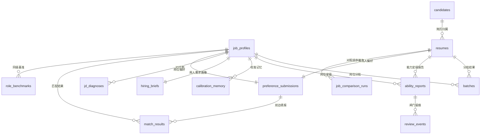

# 架构设计与数据库设计文档：人才发掘 Agent 系统

> 依据：《PRD：人才发掘 Agent 系统 v2.1（结构版本 v2.3.2：**PM 层为核心功能**；**产品伦理：档位不得被用作筛选门槛**）》《docs/05 可行性分析与路线图 v1.4》《docs/06 能力定级系统功能设计 v2.3》《docs/07 定级量规与配置表 v0.9.6》《docs/recruit/13 方向选型与需求规格化方案 v1.4.1》
> 状态：v1.6｜编制日期：2026-10-08｜**v1.7 更新：2026-10-10（同步 docs/recruit/02 v1.7.1 与 PRD v2.3.2：`batches.hard_gate_result` 枚举值由"未达门槛"改为"**规则未通过**"——"门槛"含阈值语义，违反红线 14；§2.2/§3 流程图同步；`overall_tier` 企业端渲染说明补"匹配度"禁用）**｜v1.6 更新：2026-10-10（**同步 PRD v2.3 产品伦理收口**：①**架构与表结构无改动**——两端措辞区分是**渲染层**职责，不新增数据表；②`config/` 下**新增 `presentation.json`**（两端措辞映射 + AI 偏差提示文案 + 阈值词黑名单），与量规/优先级模板同属版本化配置资产；③§3.3 表说明补"`match_results` 供两端渲染共用，**严禁企业端单独计算**"；④§2.3 补渲染层与确定性层的边界说明）｜v1.5 更新：2026-10-10（**同步 PRD v2.2「PM 层为核心功能」**：§2.3 新增层级说明段——`match_results` 所属的 Matching 引擎为核心功能，其余 Agent 为支撑件；**架构与表结构无改动**）｜v1.4 更新：2026-10-10（**同步 13 号文 v1.2「双边偏好匹配平台」定位**：新增 5 表——`preference_submissions` 双边偏好填报、`match_results` 匹配结果、`hiring_briefs` 用人需求画像、`jd_diagnoses` JD 诊断、`job_comparison_runs` 岗位对照排序批次；`role_benchmarks` 用途扩为"JD 诊断 + 求职者端披露"双用；**表数 10 → 15**）｜供开发/评审使用
> 标注【待确认】处为 PRD 未明确、需评审拍板的事项
> **范围提示**：本文档描述 MVP（阶段 0+1）落地架构；Sourcing/Outreach Agent 属阶段 3，本文仅预留接口位置与扩展说明
> **（v1.7）术语边界说明**：**红线 14 的"零阈值语义"约束的是对用户可见的呈现层文本**（页面标题/按钮/提示语/空状态/导出文件/演示脚本）。**内部技术术语与统计概念不受此约束**——如 `k-匿名阈值`、`sample_size < 20` 拒绝返回、`hard_requirements` 字段释义等属工程语言，可继续使用。**判定分界：会渲染给用户看的字，才受红线 14 管**；但为降低漂移风险，本文已把易漂移的组件名"硬门槛规则引擎"统一为"**硬规则引擎**"。详见 02 号 §2.2.1/§5 自查脚本。

## 目录

- [1. 概述](#1-概述)
- [2. 系统架构设计](#2-系统架构设计)
- [3. 数据库设计](#3-数据库设计)
- [4. 数据管道](#4-数据管道)
- [5. 待确认清单](#5-待确认清单)

---

## 1. 概述

| 项 | 内容 |
|----|------|
| 系统 | 人才发掘 Agent 系统（Talent Discovery Agent System） |
| 核心定位 | **双边偏好匹配平台**：企业导入岗位与氛围、求职者导入简历与期望，系统用**同一套偏好维度与能力量规**给出**可追溯的匹配建议**；建议不强制，判断权归双方。内部链路：JD 解析 → 批量初筛分批 → **能力定级（档位制）** → 人工闸门决策；并叠加**需求层（RQ，审查标准侧）**与**求职者端（TM）** |
| 规模定位 | 个人求职作品项目，demo 级单并发，Docker 单节点部署 |
| 技术栈（锁定） | FastAPI + Streamlit + SQLite + Chroma + bge-m3/bge-reranker + DeepSeek API，沿用既有工程基建 |
| Agent 硬约束 | **Agent 为架构核心**：多 Agent 协作 + 工具调用 + 记忆沉淀 + 人工闸门；LLM 只做**定档与证据定位**，档位汇总与门禁用确定性代码 |

## 2. 系统架构设计

### 2.1 整体架构

```
┌────────────────────── Streamlit HR 工作台 ──────────────────────┐
│ 岗位管理 / 简历批次 / 能力定级报告 / 候选人比较 / 审计 / 配置     │
└──────────────┬─────────────────────────────────────────────────┘
               │ HTTP REST（JSON）
               ▼
      FastAPI 服务层（Pydantic v2 校验；/jobs /resumes /batches
                /assessments /reviews /audit /config /health）
   ┌───────────────────────────────────────────────────────┐
   │              Agent 编排层（Orchestrator）              │
   │  任务状态机：解析→分批→定级→报告；失败降级与熔断       │
   └───┬──────────┬──────────────┬──────────────┬──────────┘
       ▼          ▼              ▼              ▼
┌──────────┐┌──────────┐ ┌──────────────┐┌────────────┐
│JD 解析    ││Matching  │ │Evaluation    ││Audit Agent │
│Agent     ││Agent     │ │Agent（定级）  ││（横切：合规 │
│（抽取）   ││（比对分批）│ │（量规定档）   ││ /偏见/成本）│
└────┬─────┘└────┬─────┘ └──────┬───────┘└─────┬──────┘
     │           │              │              │
     └───────────┴──────┬───────┴──────────────┘
                        ▼
        ┌────────────────────────────────────┐
        │ 确定性层（非 LLM）                   │
        │ · 硬规则引擎（MT-003）               │
        │ · 成绩标准化换算与落档（EV-003）     │
        │ · 档位汇总与排序键生成（EV-005）     │
        │ · 类目/维度优先级/量规配置装载       │
        └────────────────────────────────────┘
                        ▼
   ┌──────────────────────────────────────────────────┐
   │ SQLite（job_profiles / candidates / resumes /     │
   │  batches / ability_reports / review_events /      │
   │  calibration_memory / audit_logs / fit_reports /  │
   │  role_benchmarks）                                │
   │ Chroma（resume_chunks：简历向量粗排）              │
   │ 文件存储（简历原文 raw_files/，量规与映射表 JSON） │
   └──────────────────────┬───────────────────────────┘
                          ▼
     bge-m3 / bge-reranker（本地：粗排与重排，CPU 推理）
                          │ HTTPS API
     DeepSeek API（外部：Agent 推理 / 定档 / 抽取 / 命名）
```

**设计要点（四条硬规则）**：

1. **LLM 与确定性分离**：Agent 只负责"按量规定档 + 定位证据 + 生成理由"；硬规则过滤、成绩标准化落档、**档位汇总与排序键生成**、状态机流转全部由确定性代码执行——**排序键不可能被 LLM 臆造，系统也不产出任何总分**（EV-005）。
2. **Agent 不直连数据库**：所有读写经服务层（Pydantic 校验 + 审计写入）；Agent 输出为结构化对象，schema 校验失败重试 1 次后转人工，不留半成品档位（§PRD 11 异常清单）。
3. **人工闸门是架构组件而非页面功能**：ability_reports.status 为报告生效开关（SYS-001），未确认报告不进入候选人比较视图。
4. **敏感属性在输入层剥离**：candidates.sensitive_attrs 与联系方式独立存储，编排层在构造 Agent 输入前剔除（AU-001）；审计记录访问行为。

### 2.2 技术选型

| 层 | 选型 | 说明 |
|----|------|------|
| 前端 | Streamlit | HR 工作台，st.navigation 分页面；沿用既有前端经验 |
| 服务 | FastAPI + Uvicorn | REST/JSON + Pydantic v2 强校验（**定级 schema** 落点） |
| Agent 编排 | 自研轻量编排器（Python 状态机 + 结构化输出重试） | 【待确认】是否引入 LangGraph——MVP 建议自研，避免框架学习成本；若引入须评估其对可复现性的影响 |
| LLM | DeepSeek API | 唯一外部依赖，OpenAI 兼容封装，可整体替换 |
| Embedding/重排 | bge-m3 + bge-reranker（本地） | 模型权重已在本地缓存；简历粗排与重排 |
| 向量库 | Chroma | collection `resume_chunks`（简历片段向量，用于粗排与"相似候选人"） |
| 业务库 | SQLite（WAL） | **15 张核心表**（§3.3；v1.4 由 10 张扩为 15 张） |
| 文件存储 | 本地目录卷 | 简历原文 `raw_files/`；配置资产 JSON（量规/**维度优先级模板**/专业映射） |
| 部署 | Docker Compose | 复用部署方案；模型权重打入镜像层 |

### 2.3 Agent 职责与契约

| Agent | 输入 | 工具调用 | 输出（结构化） | 失败降级 | 人工闸门 |
|-------|------|---------|---------------|---------|---------|
| JD 解析 Agent（JD-001） | JD 文本 | LLM 抽取 | 岗位画像 JSON（硬性要求/加分项/隐性能力/方向关键词） | 抽取失败→提示手工录入画像 | 画像确认后才能开工（JD-002） |
| Matching Agent（MT-001/002） | 岗位画像 + 单份简历档案 | LLM 逐条比对 + 向量粗排 | 命中/缺口清单（附简历原文证据）+ 三档分批 + 分档理由 | 输出校验失败→重试 1 次→人工队列 | 分批结果为排序工具，无需逐份确认；低置信批次人工复核 |
| Evaluation Agent（EV-001~006、**EV-008~011**） | 画像 + 简历 + 量规 + **维度优先级模板** + **技能判据表**；（EV-008~010）已确认报告 + 缺口/技能缺口 | 证据检索 + 量规**定档**（跨档输出区间）+ **技能熟练度定级（L1~L4）** + LLM 自评置信度；（EV-009）结构视图与摘要句生成；（EV-008/010）追问与待验证清单生成 | **维度档位明细（档位/区间/理由/证据）** + 置信度 + **熟练度矩阵 + 结构视图 + 待验证清单 + 追问清单** | ≥2 维证据不足→整份标"建议人工复核"；追问/清单生成失败不影响报告 | **报告必须人审后生效**（SYS-001） |
| Audit Agent（AU-001/002/003，简化版） | 全链路日志 + 对照简历对 + **锚定样本集（AU-003）** | 可见性抽检 + **档位差异**计算 + **定期重跑锚定样本、计算各维跨档率** | 审计告警记录（含漂移告警与版本信息） | 检测脚本离线运行（MVP），结果人工录入 audit_logs；监控失败不影响在线定级 | 告警进审计中心待处理 |
| **需求 Agent（RQ-001/002/003，v1.4 新增）** | JD 原文 + 岗位画像 + **同级基准 `role_benchmarks`** + 澄清答问 | LLM 生成澄清问题与选项、来源溯源、三类诊断 | `hiring_briefs`（需求条目 + 来源标签 + 可评性）/ `jd_diagnoses`（三类诊断 + 原文定位） | 澄清生成失败→跳过并标"需求未澄清"；诊断无问题返回 0 条（**不硬造**） | 需求画像可选人审；诊断**只陈述事实**，不评价企业 |
| **Matching 引擎（EXT：双边偏好，v1.4）** | 两侧 `preference_submissions`（**同 `dimension_version`**）+ 简历画像 | **确定性规则比对**（非 LLM 自由发挥） | `match_results`（逐维档位 + 双引原文 + 无法判断原因） | 版本不一致→拒绝匹配并提示；一方未填报→该维输出"无法判断" | **不做自动决策**；结果供双方参考，判断权归用户 |
| Sourcing Agent（阶段 3，预留） | 画像 + 检索条件 | 人才库/公开渠道检索 | 候选人长名单 + 来源证据 | — | 长名单人审 |
| Outreach Agent（阶段 3，预留） | 确认候选人 | 话术生成 | 触达草稿 | — | **禁止自动发送** |

> **v1.4 说明**：① 需求 Agent 与既有 JD 解析 Agent 边界清晰——**JD Agent 回答"JD 写了什么"，需求 Agent 回答"实际要什么、要求是否站得住"**；② 双边偏好匹配走**确定性规则引擎**而非 LLM 自由判断，因为匹配依据必须来自双方**主动填报的结构化字段**（13 号文 §1.3 采纳护栏 2）——这是"可验证"的唯一出路；③ 匹配引擎**不直连数据库**，与既有分层纪律一致。
>
> **v1.5 层级说明（不改变本节内容）**：依 PRD §1.1.1，**`match_results` 所属的 Matching 引擎（EXT：双边偏好，PM 层）是产品核心功能**；上表其余 Agent 与引擎均为**服务于它的支撑件**——JD Agent 提供企业侧结构化输入、需求 Agent 提供企业侧真实需求、MT 提供候选集、EV 提供能力画像、AU 提供合规与漂移保障。**架构上没有任何改动，只是明确了谁服务于谁**：这也是"分层依赖规则"（§2.5）在功能层级上的投影。

### 2.4 端到端时序（黄金任务流）

```
HR           前端         FastAPI      编排器        Agent/规则层        存储
 │  粘贴 JD   │             │            │               │              │
 ├───────────►│─POST /jobs─►│──解析任务──►│──JD解析Agent──►│──LLM抽取────►│
 │            │             │            │               │              │ job_profiles
 │  确认画像  │             │            │               │              │
 ├───────────►│─PUT /jobs/{id}/confirm──►│ 画像版本锁定(v2)────────────►│
 │  导入简历  │             │            │               │              │
 ├───────────►│─POST /resumes/batch─────►│──规则引擎(硬规则)───────────►│ batches(规则未通过标记)
 │            │             │            │──Matching Agent─────────────►│ batches(三档)
 │  发起定级  │             │            │               │              │
 ├───────────►│─POST /assessments {job,batch}►│──Evaluation Agent────►│
 │            │             │            │   ├ 量规定档(LLM)            │
 │            │             │            │   ├ 成绩标准化落档(代码)     │
 │            │             │            │   └ 档位汇总与排序键(代码)──►│ ability_reports(待确认)
 │  审阅报告  │◄─GET /assessments/{id}───┤               │              │
 │  改档/确认/打回│─POST /reviews───────►│───────────────────────────►│ review_events + calibration_memory
 │  排序输出  │◄─GET /candidates/ranking┤（仅已确认报告进入）          │
```

### 2.5 分层依赖规则（开发纪律）

| 规则 | 说明 |
|------|------|
| R1 | 上层可调下层，下层不得反向依赖（Agent 不得直接 import 页面代码） |
| R2 | Agent 层禁止读写数据库，只返回结构化对象；持久化由服务层完成 |
| R3 | 确定性层（规则/成绩标准化落档/**档位汇总与排序键生成**）不得调用 LLM；Agent 层不得自行实现档位汇总或排序 |
| R4 | 所有 Agent 输入在编排层统一做敏感属性剔除与 PII 脱敏，Agent 内部不可见 |
| R5 | 每次 Agent 调用写审计字段：agent 名、模型版本、prompt 版本、时长、token 成本（可复现性要求） |

## 3. 数据库设计

### 3.1 设计约定

- 主键 `id INTEGER PRIMARY KEY AUTOINCREMENT`；外键按字段名约定，启用 `PRAGMA foreign_keys=ON`。
- 时间 `TEXT` ISO8601；日期 `TEXT`（YYYY-MM-DD）。
- JSON 字段以 SQLite TEXT 存储，读写经 Pydantic 校验。
- 配置资产（量规、专业-领域映射、**维度优先级模板**）为**独立 JSON 文件**并带版本号，不入 SQLite——版本变更是审计与可复现性的关键（EV-007 冻结机制）。
- 敏感属性与联系方式**独立列存放**并在服务层读取时显式豁免（AU-001）。
- **（v1.2 新增，SYS-005）全局标记字段**：所有业务表须携带 `data_origin`（synthetic / real）与 `env`（dev / demo / prod），由写入管道统一写入（禁止人工维护）；清理脚本据此精确删除，聚合表清理后须重算。
- **（v1.4 新增）版本化配置字段**：凡消费配置资产（量规、维度优先级、**双边偏好维度表**）的表，必须记录所用**配置版本号**；偏好维度表是**唯一版本化配置**（EV-007 纪律），两侧填报字段口径必须同源（13 号文 §8 红线 13）。
- **（v1.4 新增）自述与推导分区**：**"用户自述/企业自述"字段与"系统推导"字段在同一表内须以字段名或 JSON 分键明确区隔**，界面层据此分区呈现（企业自述的氛围描述不得与系统推导结论混排，13 号文 §3.4 纪律①）。

### 3.2 ER 关系

```
job_profiles 1───n batches            （岗位 → 分批结果）
job_profiles 1───n ability_reports    （岗位 → 能力定级报告）
candidates   1───n resumes            （候选人 → 简历档案）
resumes      1───n batches            （简历 → 分批结果）
resumes      1───n ability_reports    （简历 → 能力定级报告）
ability_reports 1───n review_events   （报告 → 人工操作留痕）
job_profiles 1───n calibration_memory （岗位 → 校准记忆）
audit_logs   独立表（可关联 batch_id / report_id / job_id）
job_profiles 1───1 hiring_briefs      （岗位画像 → 用人需求画像 v1.4）
job_profiles 1───n jd_diagnoses       （岗位画像 → JD 诊断结果 v1.4）
resumes      1───1 preference_submissions（简历 → 候选人偏好填报 v1.4）
job_profiles 1───1 preference_submissions（岗位 → 企业侧偏好填报 v1.4）
preference_submissions 1───n match_results（偏好填报 → 匹配结果 v1.4）
job_profiles 1───n match_results      （岗位 → 匹配结果 v1.4）
resumes      1───n job_comparison_runs（简历 → 岗位对照排序批次 v1.4）
job_profiles 1───n role_benchmarks    （岗位 → 同级岗位基准聚合 v1.4）
```



### 3.3 表结构设计

#### 3.3.1 job_profiles（岗位画像，JD-001/002）

| 字段 | 类型 | 约束 | 说明 |
|------|------|------|------|
| id | INTEGER | PK | |
| job_id | TEXT | UNIQUE, NOT NULL | 岗位编号 JOB-YYYYMM-序号 |
| version | INTEGER | NOT NULL, DEFAULT 1 | 画像版本；确认后锁定，变更须新版本 |
| title | TEXT | NOT NULL | 岗位名 |
| hard_requirements | TEXT | NOT NULL, JSON | 硬性要求（学历/专业/技能门槛） |
| bonus_points | TEXT | NULL, JSON | 加分项 |
| implicit_capabilities | TEXT | NULL, JSON | 隐性能力 |
| direction_keywords | TEXT | NOT NULL, JSON | 方向关键词集合（D3"对口"判据基准） |
| source_jd | TEXT | NOT NULL | JD 原文 |
| confirmed_by / confirmed_at | TEXT | NULL | 画像确认人与时间（JD-002） |
| **pack_version** | TEXT | NULL | **标准包版本（SYS-004）**：该岗位画像与量规/**维度优先级**来源的 pack 版本号；手工创建为 NULL |
| created_at | TEXT | NOT NULL | |

#### 3.3.2 candidates（候选人主档）

| 字段 | 类型 | 约束 | 说明 |
|------|------|------|------|
| id | INTEGER | PK | |
| candidate_id | TEXT | UNIQUE, NOT NULL | C-YYYY-序号 |
| display_name | TEXT | NOT NULL | 脱敏名（合成数据） |
| contact | TEXT | NULL | 联系方式——**隔离字段**，不进入任何 Agent 输入 |
| sensitive_attrs | TEXT | NULL, JSON | 性别/年龄/民族/婚育等——**隔离字段**，Agent 不可见（AU-001） |
| created_at | TEXT | NOT NULL | |

#### 3.3.3 resumes（简历档案，MT-001）

| 字段 | 类型 | 约束 | 说明 |
|------|------|------|------|
| id | INTEGER | PK | |
| candidate_id | TEXT | NOT NULL, FK→candidates, 索引 | |
| parsed | TEXT | NULL, JSON | 结构化档案：教育/成绩(GPA,排名)/项目/技能/实习 |
| raw_file_path | TEXT | NOT NULL | 原文路径（raw_files/） |
| parse_status | TEXT | NOT NULL, CHECK IN (成功,失败,待人工) | 失败个体入人工队列不阻塞批次 |
| parse_error | TEXT | NULL | |
| created_at | TEXT | NOT NULL | |

#### 3.3.4 batches（初筛分批，MT-002/003）

| 字段 | 类型 | 约束 | 说明 |
|------|------|------|------|
| id | INTEGER | PK | |
| job_id | TEXT | NOT NULL, FK→job_profiles, 索引 | |
| resume_id | INTEGER | NOT NULL, FK→resumes | |
| hard_gate_result | TEXT | NOT NULL, CHECK IN (通过,规则未通过) | 规则引擎产物（MT-003），附规则编号。**（v1.7）枚举值由"未达门槛"改为"规则未通过**——"门槛"含阈值语义，违反红线 14 |
| hard_gate_rule_ids | TEXT | NULL, JSON | 命中的规则编号（可追溯） |
| tier | TEXT | NOT NULL, CHECK IN (高匹配,潜力,存疑) | 三档分批（排序工具，非淘汰） |
| hits | TEXT | NULL, JSON | 命中清单（附简历原文证据） |
| misses | TEXT | NULL, JSON | 缺口清单（附证据） |
| tier_reason | TEXT | NOT NULL | 分档理由 |
| created_at | TEXT | NOT NULL | |

索引：`(job_id, tier)`、`(resume_id)`。

#### 3.3.5 ability_reports（能力定级报告，EV-001~011；v1.3 更名，原 score_reports）

| 字段 | 类型 | 约束 | 说明 |
|------|------|------|------|
| id | INTEGER | PK | |
| report_id | TEXT | UNIQUE, NOT NULL | RPT-YYYYMM-序号 |
| job_id | TEXT | NOT NULL, FK, 索引 | |
| resume_id | INTEGER | NOT NULL, FK, 索引 | |
| **tiers** | TEXT | NOT NULL, JSON | 维度档位数组：{id,name,**priority**,**tier(B1~B5 / insufficient)**,**tier_range**,cross_band_reason,rationale,evidence[],insufficient}。**无任何分数字段** |
| **sort_key** | TEXT | NOT NULL, JSON | **EV-005 排序键**：{qualified_dims, ordered_tiers[], evidenced_dims}；由确定性层生成 |
| confidence | TEXT | NOT NULL, CHECK IN (high,low) | ≥2 维证据不足或存在无证据推断→low |
| **priority_version** / rubric_version / profile_version | TEXT | NOT NULL | 三版本号——可复现性（EV-005/007） |
| model_version | TEXT | NOT NULL | LLM 模型版本 |
| status | TEXT | NOT NULL, CHECK IN (待确认,已确认,已打回), 索引 | 人工闸门（SYS-001） |
| **followups** | TEXT | NULL, JSON | **EV-008 缺口追问清单**：[{dimension_id, gap_evidence[], question}]；仅对已确认报告生成，生成失败为 NULL 且不影响报告 |
| **skill_levels** | TEXT | NULL, JSON | **EV-011 熟练度定级**：[{skill, self_reported, evidence_level(L), required_level(R), ladder(B1~B5), evidence[]}] |
| **structure_view** | TEXT | NULL, JSON | **EV-009 结构视图**：{strengths[], weaknesses[], insufficient[], summary_sentence} |
| **open_questions** | TEXT | NULL, JSON | **EV-010 待验证清单**：[{type: 简历自评高于描述/关键项缺失, item, hint}]（**仅报告面试准备区呈现**） |
| assessed_at / confirmed_at | TEXT | NOT NULL / NULL | |

**约束**：①`sort_key` 仅由确定性计算层写入，服务层拒绝任何来自 Agent 的直接赋值（EV-005）；②本表**不存在 composite_score / 分数 / 百分比权重字段**——定级范式下系统既不存储也不输出总分。

> **v1.3 移除字段**：`composite_score`、`composite_mode`、`weights_version`、`missing_evidence_policy`（原 redistribute/zero 缺证据策略）——均为分数合成体系的产物。

#### 3.3.6 review_events（人工闸门与改档留痕，EV-006/SYS-001/002）

| 字段 | 类型 | 约束 | 说明 |
|------|------|------|------|
| id | INTEGER | PK | |
| report_id | TEXT | NOT NULL, FK→ability_reports, 索引 | |
| action | TEXT | NOT NULL, CHECK IN (确认,单维改档,整份打回) | |
| dimension_id | TEXT | NULL | 单维改档时填 D1~D5 |
| **tier_before / tier_after** | TEXT | NULL | 改档前后的档位（如 `B4` → `B3`）；v1.3 起替代原 score_before/after |
| reason | TEXT | NOT NULL | **必填**（EV-006 验收） |
| operator / created_at | TEXT | NOT NULL | |

#### 3.3.7 calibration_memory（校准记忆，SYS-002）

| 字段 | 类型 | 约束 | 说明 |
|------|------|------|------|
| id | INTEGER | PK | |
| job_id | TEXT | NOT NULL, FK, 索引 | |
| dimension_id | TEXT | NULL | 维度级修正；NULL 表示岗位级偏好 |
| pattern | TEXT | NOT NULL, JSON | 修正模式（如"该校招岗位 D3 偏紧，同类项目应**上调一档**"） |
| source_event_id | INTEGER | NOT NULL, FK→review_events | 来源留痕（可回溯） |
| confirmed | INTEGER | NOT NULL, DEFAULT 0 | 记忆需确认后才注入 prompt（防记忆污染，11 章） |
| deleted_at | TEXT | NULL | 软删除（可回溯删除） |
| created_at | TEXT | NOT NULL | |

#### 3.3.8 audit_logs（审计，AU-001/002）

| 字段 | 类型 | 约束 | 说明 |
|------|------|------|------|
| id | INTEGER | PK | |
| event_type | TEXT | NOT NULL, CHECK IN (敏感属性访问,偏见检测,Agent 调用,配置变更,**漂移监控**,**数据清理**), 索引 | 漂移监控为 AU-003 产出；数据清理为 SYS-005 产出 |
| ref_id | TEXT | NULL | 关联 batch_id / report_id / job_id |
| detail | TEXT | NOT NULL, JSON | 如对照简历对**档位差异**、跨档率、模型/token/时长 |
| result | TEXT | NULL, CHECK IN (正常,告警) | 对照简历对**任一维度档位差 ≥1 档**→告警 |
| operator / created_at | TEXT | NOT NULL | |

#### 3.3.9 Chroma collection：resume_chunks（向量粗排）

| metadata 字段 | 说明 |
|--------------|------|
| resume_id / candidate_id | 归属 |
| section | 片段来源（教育/项目/技能/实习） |
| job_tag | 建库时所属岗位（可选，用于岗位内粗排） |

> 每份简历向量化后的片段供 Matching Agent 粗排与"相似候选人"扩展使用；原文仍以 raw_files/ 为准（Chroma 可重建）。

#### 3.3.10 fit_reports（人才端适配分析，TM-001，v1.1 新增）

| 字段 | 类型 | 约束 | 说明 |
|------|------|------|------|
| id | INTEGER | PK | |
| fit_id | TEXT | UNIQUE, NOT NULL | FIT-YYYYMM-序号 |
| resume_id | INTEGER | NOT NULL, FK→resumes, 索引 | 求职者本人简历 |
| target_job_profile_id | TEXT | NOT NULL, FK→job_profiles | 由用户导入 JD 解析出的岗位画像（source_type='user_import'） |
| fit_ladder | TEXT | NOT NULL, CHECK IN (B1,B2,B3,B4,B5) | 适配档位 |
| hits / misses | TEXT | NOT NULL, JSON | 命中/缺口清单，**每条附简历或 JD 原文引用** |
| gap_levels | TEXT | NULL, JSON | 缺口差距级别：[{skill, required_level(R), evidence_level(L), gap}] |
| rubric_version / pack_version | TEXT | NOT NULL | 可复现性；两侧共用同一标准包（"双边同尺"） |
| created_at | TEXT | NOT NULL | |

> **边界**：本表不含录用概率、薪资预测字段（明确不做）；求职者侧数据与企业侧候选人数据物理隔离，求职者仅可见本人 fit_reports。

#### 3.3.11 role_benchmarks（岗位参考基准聚合视图，TM-005，v1.2 新增）

| 字段 | 类型 | 约束 | 说明 |
|------|------|------|------|
| id | INTEGER | PK | |
| job_profile_id | TEXT | NOT NULL, FK→job_profiles, 索引 | 对应岗位画像 |
| dimension_or_skill | TEXT | NOT NULL | 维度（D1~D5）或技能名 |
| distribution | TEXT | NOT NULL, JSON | **聚合**区间/分位统计（如 {"B3":4,"B4":11,"B5":5}） |
| sample_size | INTEGER | NOT NULL | 参与统计的样本数 |
| source_type | TEXT | NOT NULL, CHECK IN (A_derived,B_synthetic,C_real_feedback) | A 推导基准 / B 合成统计 / C 真实回流（阶段 3，须授权） |
| rubric_version | TEXT | NOT NULL | 口径一致性 |
| updated_at | TEXT | NOT NULL | |

> **硬约束（架构级）**：①只存**聚合统计，禁止存个体记录**；②读取接口在 `sample_size < 20` 时**拒绝返回**（k-匿名阈值，服务层强制而非前端判断）；③不提供任何按候选人/个体的查询接口；④C 档数据来源须带企业授权记录方可写入。
>
> **v1.4 用途扩展**：本表由"仅向求职者披露"扩为**双消费者**——① **RQ-003「超出同级基准」诊断**（内部，生产侧）；② **TM-005 岗位参考基准对外披露投影**（求职者可见）。**同一份基准、两个消费者、一套口径**（详见 `docs/recruit/11`）。

#### 3.3.12 hiring_briefs（用人需求画像，RQ-001/002，v1.4 新增）

| 字段 | 类型 | 约束 | 说明 |
|------|------|------|------|
| id | INTEGER | PK | |
| brief_id | TEXT | UNIQUE, NOT NULL | HBR-YYYYMM-序号 |
| job_id | TEXT | NOT NULL, FK→job_profiles, UNIQUE, 索引 | 一个岗位画像对应一份需求画像 |
| requirements | TEXT | NOT NULL, JSON | 需求条目数组：[{content, type(硬性/加分), source_tag, assessable, priority(P0/P1/P2), origin(JD原文/澄清补充), jd_quote}] |
| clarification_qa | TEXT | NULL, JSON | 澄清问答记录：[{question, options[], answer, answered_at}]；**答"不清楚"记 `未澄清`，不代填** |
| unclarified_count | INTEGER | NOT NULL, DEFAULT 0 | `未澄清` 条目数（**不得进入 P0 优先级**） |
| **priority_version** / rubric_version | TEXT | NOT NULL | 可复现性 |
| confirmed_by / confirmed_at | TEXT | NULL | 需求画像确认（可选） |
| created_at | TEXT | NOT NULL | |

> **硬约束**：①追问问题数 ≤7、每题给定选项；②`source_tag` ∈ {团队能力缺口, 业务需要, 合规或硬性制度, 模板惯性, 未澄清}；**无来源标签的要求不得进入 P0 优先级**（RQ-002）；③`未澄清` 条目在报告中显式显示为"需求未澄清"，**不参与 P0**。
> **区分 JD 与 Brief 是有意设计**：JD 是"对外广告"，Brief 是"对内规格"；**JD 缺失但需求真实存在** → 补进 Brief 并标 `origin=澄清补充`。

#### 3.3.13 jd_diagnoses（JD 诊断结果，RQ-003，v1.4 新增）

| 字段 | 类型 | 约束 | 说明 |
|------|------|------|------|
| id | INTEGER | PK | |
| diagnosis_id | TEXT | UNIQUE, NOT NULL | JDD-YYYYMM-序号 |
| job_id | TEXT | NOT NULL, FK→job_profiles, 索引 | 被诊断岗位 |
| profile_version | INTEGER | NOT NULL | 诊断所依据画像版本（画像变更须重诊断） |
| findings | TEXT | NOT NULL, JSON | 诊断条目数组：[{type, jd_quote, statement, dimension_id, benchmark_ref}]；**type 仅三类**：`内部矛盾` / `超出同级基准` / `不具备可评性` |
| finding_count | INTEGER | NOT NULL, DEFAULT 0 | **为 0 时表示"未发现可确定的问题"（不硬造）** |
| benchmark_version | TEXT | NULL | 引用 SC-002 同级基准的口径版本（`超出同级基准` 类条目必填） |
| rubric_version | TEXT | NOT NULL | 可复现性 |
| created_at | TEXT | NOT NULL | |

> **硬约束**：①**只做三类可确定、可定位原文的诊断**；②每条**必须带 `jd_quote` 原文定位**；③**不给"这份 JD 好不好"的总评**，不评价企业、不评价薪酬、**不提供改写后的 JD 文案**（红线 4）；④**双端投影**——同一份诊断，企业侧显示为"待确认项"，求职者侧显示为"该岗位要求的可评估性提示"（TM-001 组成部分），**同一结论、两个方向、不产生两套口径**。

#### 3.3.14 preference_submissions（双边偏好填报，v1.4 新增）

> **本表是"匹配"的唯一依据来源**——系统**不**从自然语言中"感觉"推断偏好（13 号文 §1.3 采纳护栏 2）。

| 字段 | 类型 | 约束 | 说明 |
|------|------|------|------|
| id | INTEGER | PK | |
| submission_id | TEXT | UNIQUE, NOT NULL | PREF-YYYYMM-序号 |
| side | TEXT | NOT NULL, CHECK IN (enterprise, candidate) | 填报方 |
| **job_id** | TEXT | NULL, FK→job_profiles, 索引 | 企业侧必填；候选人侧为 NULL |
| **resume_id** | INTEGER | NULL, FK→resumes, 索引 | 候选人侧必填；企业侧为 NULL |
| **ambience_text** | TEXT | NULL, 仅企业侧 | **企业氛围描述**——**企业自行填写**（自述字段），系统**不代写、不润色、不评判**；界面须标注"企业自行填写"（**不得使用"未经核验/真实性"字样**，13 号文表述纪律③） |
| dimensions | TEXT | NOT NULL, JSON | 维度填报数组：[{dimension_id, value, filled(bool), source(自述)}]；**必填 3 项**（技术方向偏好 / 自主性 / 学习与成长倾向），其余选填 |
| unfilled_dims | TEXT | NULL, JSON | 跳过项列表（记 `未填报`，**不代填、不猜测**；匹配时不参与计算但**显式标注**） |
| **dimension_version** | TEXT | NOT NULL | **双边偏好维度表版本**（唯一版本化配置，EV-007 纪律；红线 13：两侧口径必须同源） |
| **data_origin** / env | TEXT | NOT NULL | SYS-005 全局标记 |
| submitted_at / updated_at | TEXT | NOT NULL | |

> **硬约束**：①**必填项不得增加**（填得越多越不填，是明确的雷点）；②两侧填报字段**必须同源同版本**（`dimension_version` 相同）才能参与匹配，否则拒绝匹配并提示版本不一致；③`未填报` 项**不得推断**，且**"无法判断/不愿透露"是合法答案**。

#### 3.3.15 match_results（匹配结果，v1.4 新增）

> **本表是 13 号文 §1.3 采纳护栏 3 与红线 12 的落地点**：不出现百分比，只出档位；每个档位必须可展开到双方原文。

| 字段 | 类型 | 约束 | 说明 |
|------|------|------|------|
| id | INTEGER | PK | |
| match_id | TEXT | UNIQUE, NOT NULL | MATCH-YYYYMM-序号 |
| job_id | TEXT | NOT NULL, FK→job_profiles, 索引 | |
| resume_id | INTEGER | NOT NULL, FK→resumes, 索引 | |
| **ent_submission_id / cand_submission_id** | TEXT | NOT NULL, FK→preference_submissions | **双方填报快照引用**——缺一不可，否则无法复现 |
| **dimension_results** | TEXT | NOT NULL, JSON | 逐维结果：[{dimension_id, tier(高/中/低/无法判断), unmatched_reason, ent_quote, cand_quote}]；**`tier` 仅四态，无任何数值** |
| **overall_tier** | TEXT | NOT NULL, CHECK IN (高,中,低,无法判断) | 整体结果（**由维度结果按确定性规则汇总，无加权、无百分比**）；**（v1.6）本字段是两端渲染的同一数据源**——企业端渲染为"与岗位要求的差距（高于要求/相符/低于要求 {n} 级）"、求职者端渲染为"档位/距离"，**严禁为企业端单独计算**（红线 13/14）；**（v1.7）企业端"匹配度"一词亦禁用** |
| **dimension_version** / rubric_version | TEXT | NOT NULL | **两侧口径同源证明**（红线 13） |
| engine_version | TEXT | NOT NULL | 匹配规则引擎版本（可复现性） |
| **data_origin** / env | TEXT | NOT NULL | SYS-005 全局标记 |
| created_at | TEXT | NOT NULL | |

> **硬约束（架构级，逐条对应红线）**：
> ① **表中不存在任何百分比 / 分数 / 权重字段**（红线 6）——整体档位与逐维档位均为枚举，**刻意不提供可算成数的表达**；
> ② **`ent_quote` / `cand_quote` 均 NOT NULL**——**无依据不得出档位**（红线 12），服务层在写入前校验；
> ③ `unmatched_reason` 记录"一方未填报 / 双方口径不同"，**"无法判断"是合法且必须支持的输出**（不得为了好看强行给档）；
> ④ **不做自动淘汰、不做自动排序晋级**（红线 1）——本表只存比对结果，**不派生任何决策动作**；
> ⑤ 本表**不作为存档快照的替代**：双方填报内容变更后，历史匹配结果仍以 `ent_submission_id/cand_submission_id` 指向的填报版本为准复现（13 号文 §3.4 纪律②）。

#### 3.3.16 job_comparison_runs（岗位对照排序批次，TM-004，v1.4 新增）

| 字段 | 类型 | 约束 | 说明 |
|------|------|------|------|
| id | INTEGER | PK | |
| run_id | TEXT | UNIQUE, NOT NULL | CMP-YYYYMM-序号 |
| resume_id | INTEGER | NOT NULL, FK→resumes, 索引 | 求职者本人简历 |
| job_texts | TEXT | NOT NULL, JSON | 用户粘贴的 N 份 JD 原文 + 各自的 `pasted_at`（**来源留痕，全部来自用户粘贴**） |
| jd_count | INTEGER | NOT NULL, CHECK (jd_count >= 2) | **少于 2 份不允许排序**，回退到 TM-001 |
| ranked_results | TEXT | NOT NULL, JSON | 排序结果：[{rank, job_ref, sort_key, qualified_dims, ordered_tiers[], evidenced_dims, basis_statement}]；**`sort_key` 由确定性层生成，与候选人排序完全同源（EV-005）** |
| rubric_version / pack_version | TEXT | NOT NULL | 两侧共用同一标准包（"双边同尺"） |
| data_origin / env | TEXT | NOT NULL | SYS-005 全局标记 |
| created_at | TEXT | NOT NULL | |

> **硬约束**：① **不扩展到用户未提供的岗位**（不补全、不猜测）；② **不显示录用概率 / 通过率 / 竞争难度**；③ 界面命名使用"**岗位对照排序**"，**不使用"推荐""匹配度排名"**等暗示外部数据源的措辞；④ `ranked_results` 中**不得出现任何数值分**，位次依据为档位排序键的逐键比较过程。

### 3.4 索引汇总

| 表 | 索引 | 服务的需求 |
|----|------|-----------|
| job_profiles | job_id UNIQUE、(version, job_id) | JD-002 版本锁定 |
| resumes | (candidate_id)、(parse_status) | MT-001 失败队列 |
| batches | (job_id, tier)、(resume_id)、(hard_gate_result) | MT-002/003、报告入队 |
| ability_reports | (job_id, status)、(resume_id)、report_id UNIQUE | SYS-001 闸门、排序输出 |
| review_events | (report_id, created_at) | 留痕与审计 |
| calibration_memory | (job_id, confirmed) | SYS-002 注入 |
| audit_logs | (event_type, created_at) | AU-001/002、成本统计 |
| hiring_briefs | brief_id UNIQUE、(job_id) UNIQUE | RQ-001/002 需求画像 |
| jd_diagnoses | (job_id, profile_version)、(finding_count) | RQ-003 诊断与双端投影 |
| preference_submissions | submission_id UNIQUE、(job_id)、(resume_id)、(side, dimension_version) | 双边填报；**版本同源校验**（红线 13） |
| match_results | match_id UNIQUE、(job_id, resume_id)、created_at | 匹配结果；**双方快照引用不可为空** |
| job_comparison_runs | run_id UNIQUE、(resume_id) | TM-004 对照排序 |
| role_benchmarks | (job_profile_id, dimension_or_skill) | RQ-003 诊断 + TM-005 披露（双消费者） |

### 3.5 核心数据流转

1. **岗位链路**：`POST /jobs`（JD 原文）→ JD 解析 Agent → job_profiles(v1, 未确认) → HR 确认页（可编辑）→ `PUT /jobs/{id}/confirm` → 锁定 version，生成方向关键词集合。
2. **分批链路**：`POST /resumes/batch` → 解析（失败入人工队列）→ 规则引擎硬规则（写 hard_gate_result，不删简历）→ Matching Agent 逐条比对（hits/misses 均带证据）→ 写 tier 与理由 → 批次视图按 tier 排序展示。
3. **定级链路**：`POST /assessments {job_id, resume_ids}` → 队列逐份：编排层剔除敏感属性 → Evaluation Agent 逐维找证据+**定档**（跨档输出区间）+ 技能熟练度定级 → 确定性层做成绩标准化落档与**档位汇总/排序键生成** → 写 ability_reports(status=待确认, 含三版本号与 sort_key)。
4. **闸门与校准链路**：HR 审阅 → `POST /reviews`（确认/改档/打回）→ review_events 留痕 → 改档模式写入 calibration_memory(confirmed=0) → 确认后注入后续**定级** prompt；整份打回连续 3 次触发熔断告警（SYS-003）。
5. **审计链路**：所有 Agent 调用与敏感字段访问写 audit_logs；偏见检测（对照简历对）结果写入 audit_logs(result=告警/正常)。
6. **需求层链路（v1.4，RQ）**：job_profiles 确认后 → RQ-001 生成 **≤7 个结构化澄清问题**（每题给选项、允许跳过）→ 产出 `hiring_briefs`（未澄清项不入 P0）→ RQ-002 逐条打 `source_tag` → RQ-003 读取 `role_benchmarks` 做三类诊断 → 写 `jd_diagnoses`；RQ-004 在定级前校验 P0 需求是否有量规覆盖，无覆盖则告警"不可评估"并**不生成该需求的任何档位**。
7. **匹配链路（v1.4，双边偏好）**：企业侧填 `preference_submissions(side=enterprise)`（含 `ambience_text` 自述）／候选人侧填 `preference_submissions(side=candidate)` → **校验两侧 `dimension_version` 同源**（不一致拒绝匹配）→ 匹配引擎逐维比对（必填 3 项 + 已填选填项）→ 写 `match_results`（逐维档位 + 双引原文 + `unmatched_reason`）→ 界面三层呈现（默认档位 / 展开依据 / 无法判断）。**全程不出百分比、不做自动决策**。
8. **求职者对照排序链路（v1.4，TM-004）**：求职者粘贴 N≥2 份 JD（`job_comparison_runs.job_texts`）→ 对每份执行 TM-001 → 用 **EV-005 同一档位排序键**排序 → 写 `ranked_results`（每名附依据）→ 界面呈现"岗位对照排序"（**不用"推荐"字样**）。

> **双端隔离红线（架构级）**：企业侧表（batches / ability_reports / match_results 的企业视角）与求职者侧表（fit_reports / job_comparison_runs）**无任何跨侧关联接口**；求职者侧只读自身记录与企业侧的**聚合基准**（`role_benchmarks`，且受 k-匿名 ≥20 服务层强制）。`match_results` 是双方填报的比对产物，**企业侧只见企业字段与档位，候选人侧只见候选人字段与档位**，双方原文互相不可见。

## 4. 数据管道

| 管道 | 说明 |
|------|------|
| 合成简历生成 | LLM 按岗位模板批量生成，刻意构造对照样本：强相关/弱相关/缺 GPA/无实习/信息不完整；人工抽检 10%。输出 `data/init/resumes/*.json` + 原文 PDF（可选） |
| 公开数据集 | 如 Kaggle 简历数据集，仅用于解析鲁棒性测试，**不得混入评测集** |
| 评测标注集 | 50 对 JD-简历：3 人独立标注匹配档与**维度档位** → Kappa ≥0.6 → 金标准（§9.2 PRD） |
| 配置资产 | `config/rubric.v0.9.json`、`config/major_domain_map.json`、**`config/priority_templates.json`（v1.3 起替代 weight_templates.json）**、**`config/preference_dimensions.json`（v1.4 新增：双边偏好维度表，唯一版本化配置，红线 13）**、**`config/presentation.json`（v1.6 新增：两端措辞映射 + AI 偏差提示文案 + 阈值词黑名单，红线 14）**、**`config/packs/*.pack.json`（SYS-004 标准包）**；变更记变更记录，冻结后改动须重校准（EV-007）；pack 导出/导入经 `GET /config/packs`、`POST /config/packs/import` |
| **偏好维度表变更处理（v1.4）** | `preference_dimensions.json` 版本变更时：① 已写入的 `match_results` 标注"基于旧版本 `dimension_version`"，**不静默重算**；② 需要新版本结论时须**双方重新填报**（因维度口径已变，旧填报不可直接复用）；③ 变更记录进与 pack 同一变更日志 |
| **双边填报合成数据（v1.4）** | 测试期企业氛围描述与偏好填报**由 LLM 合成**并强制标 `data_origin=synthetic`；**合成企业一律不得使用真实公司名**（红线 9），原始响应与生成 prompt 留痕 |

## 5. 待确认清单

| # | 事项 | 理由 |
|---|------|------|
| 1 | Agent 编排是否引入 LangGraph 等框架 | 自研轻量编排利于可复现与调试；引入框架需评估其版本对评测复现的影响 |
| 2 | 简历原文是否必须留存 PDF（还是仅结构化 JSON） | 影响文件存储与 PII 面；合成数据无风险，若接真实简历需重新评估 |
| 3 | 批次并发度与 token 成本上限 | 50 份简历**深度定级**的成本阈值未定；建议先跑 10 份测单份成本再定预算 |
| 4 | 偏见检测是否在 MVP 内做在线化 | PRD 允许离线脚本 + 人工录入；在线化可放阶段 2 |
| 5 | 标注人选（2 名同学）落实时间 | M0 阻塞项，见 PRD §9.2 |
| 6 | **双边偏好匹配的整体档位汇总规则**（v1.4 新增） | 逐维档位 → 整体档位的确定性规则需定稿：建议**先看必填 3 项**，必填项出现"低"则整体不高于"中"；**任何一项"无法判断"须显式列出**。须保证①无算术、②可复现、③可解释 |
| 7 | **匹配结果的留存期限与撤回机制**（v1.4 新增） | 双方填报内容属用户自述；用户修改填报后，历史匹配结果保留还是作废，需产品口径（建议：**保留但标"基于已过期填报"**，与新填报结果并列显示，不覆盖历史） |
| 8 | **`ambience_text` 长度与自由度过高带来的风险**（v1.4 新增） | 企业自述氛围可能写成招聘广告；系统**不代写不评判**（红线 2），但需定"是否给出填写引导/字段提示模板"——**提示模板 ≠ 代写**，须在评审时明确边界 |
| 9 | **RQ-003 诊断是否在求职者端逐条展示**（v1.4 新增） | 涉及"求职者看到企业 JD 问题"的观感；当前设计为"该岗位要求的可评估性提示"，须确认文案力度 |

> 合规输出声明：本方案为产品设计参考，具体实施请结合公司合规与法务要求确认。
