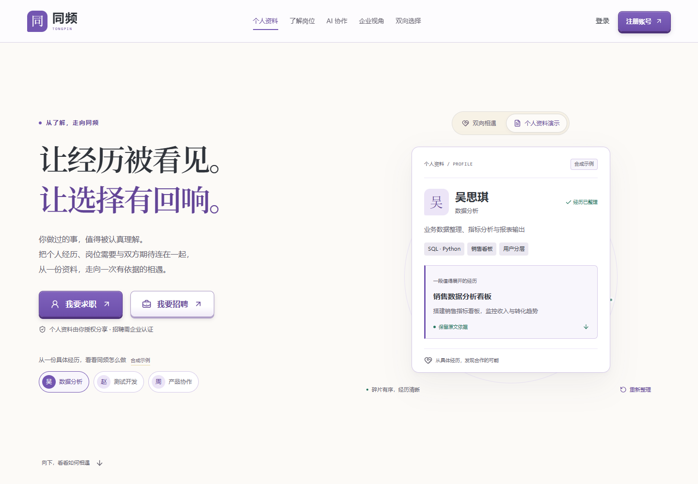
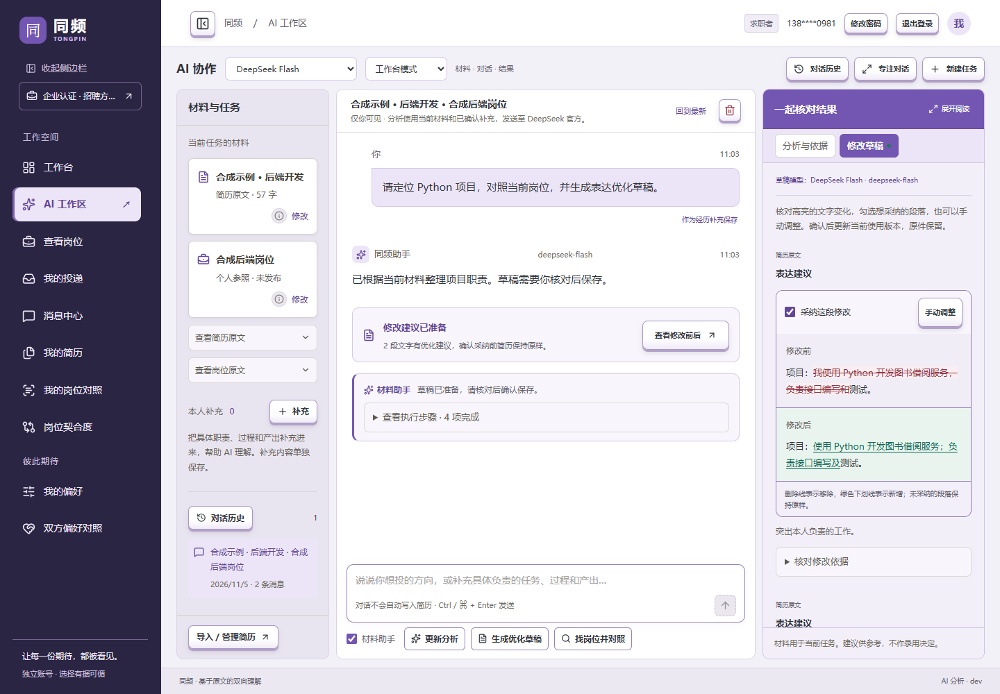
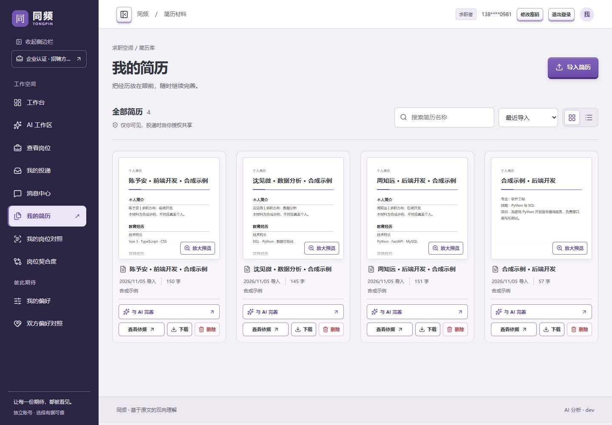
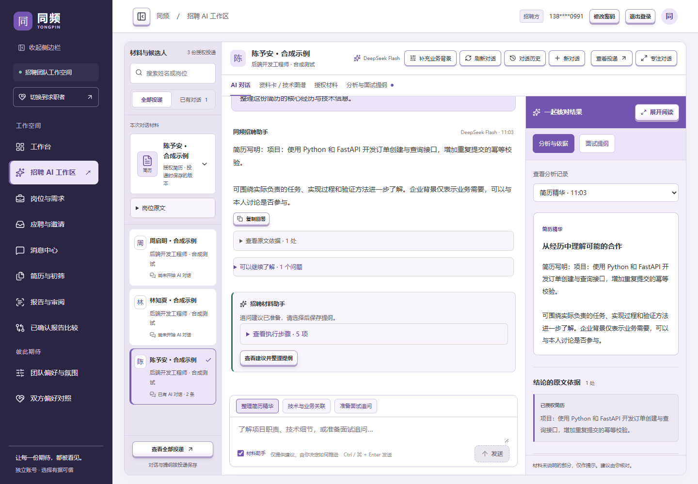
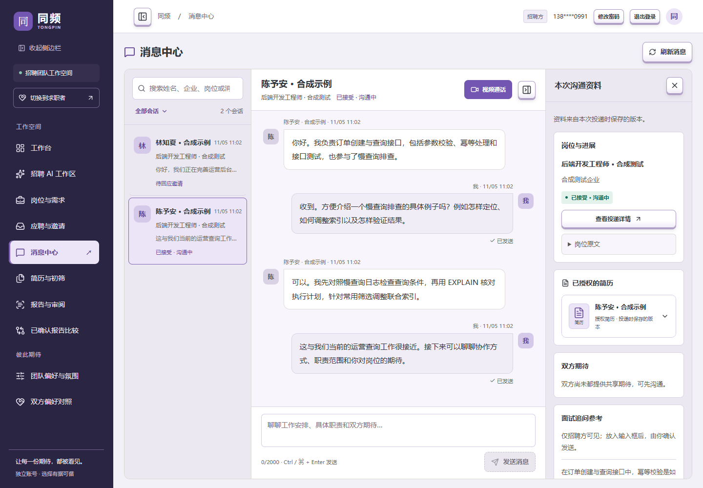
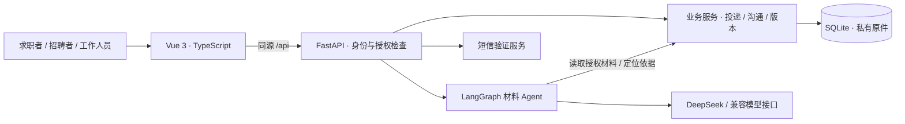

<div align="center">

# 同频 · Tongpin

### 让经历被看见，让选择有回响。

基于经历依据的求职与招聘 AI 协作平台。
把个人经历、岗位需求与双方期待连在一起，从一份资料走向一次有依据的相遇。

[](LICENSE)
[](frontend/package.json)
[](requirements.txt)
[](requirements-runtime-lock.txt)

[快速开始](#快速开始) · [界面预览](#界面预览) · [部署说明](docs/deployment.md) · [参与贡献](CONTRIBUTING.md)

</div>



> 截图中的人物、企业、账号和沟通材料均来自合成示例及隔离测试环境。AI 工作区截图使用脚本化模型响应展示交互流程，不代表真实模型效果或招聘结论。本仓库不提供公共测试账号。

## 同频能做什么

同频围绕具体经历帮助双方理解彼此：求职者整理和改善表达，企业查看已授权的材料并准备进一步沟通。AI 建议保留原文依据，由人决定是否采纳、是否推进。

| 面向谁 | 已实现的功能 |
| --- | --- |
| 求职者 | 简历库与原件预览、AI 流式对话、经历定位、修改前后对照、确认后保存新版本、岗位对照与五档契合度排序 |
| 招聘者 | 岗位画像与需求澄清、授权投递阅读、个人资料卡与技术经历结构、技术与业务关联、AI 面试追问与可编辑提纲 |
| 双方 | 主动投递、沟通邀请与接受／婉拒、独立消息中心、文件附件、岗位与资料快照、统一的期待公开设置 |
| 平台工作人员 | 企业资质审核、账号与岗位监管、操作留痕、标准配置、质量审阅与备份工具 |

岗位契合度依据已有证据判断；缺少描述时保留提示，不强制补充。招聘端能力报告需人工确认后才能参与候选人比较，系统不自动晋级、淘汰或作录用决定。

## 界面预览

### 求职 AI：从一段经历到可确认的修改

材料、对话与结果分区展示。Agent 可以定位原文、对照岗位并准备草稿；用户逐项查看文字变化、选择采纳的段落，再确认保存，原件保留。



### 简历库：把经历放在眼前

以卡片或列表管理简历，保留导入、查看依据、下载、删除和进入 AI 协作的入口。支持 PDF、DOC、DOCX、TXT、JSON；PDF 原件可预览，Word 可下载原件并提取文字供分析。



### 招聘 AI：结论旁边就是依据

围绕当前候选人的授权投递整理经历，讨论技术与企业业务的关联，生成可核对的面试追问。对话、原文依据和提纲始终围绕同一份投递。



### 双向沟通：带着岗位和双方期待继续了解

求职者主动投递，企业发出邀请，由求职者决定是否接受。独立消息中心关联岗位、已授权简历和双方期待，支持历史消息与未读提醒。



## 快速开始

### 环境要求

- Python **3.13**、Node.js **22.13 或更高的受支持 LTS 版本**、Git。
- 首次安装需要联网。默认使用 SQLite，无需另装 MySQL 或 Redis。
- 旧 DOC 文件的解析需要 `antiword`；Ubuntu 可安装 `sudo apt-get install antiword`，项目 Docker 镜像已包含。

### 下载与启动

```bash
git clone https://github.com/lionOvO/tongpin.git
cd tongpin
python start.py --install
```

Windows 也可双击根目录的 **`一键启动.bat`**；Linux / macOS 可使用 `python3 start.py --install`。启动脚本创建虚拟环境、复制缺失的 `.env`、安装锁定依赖，并启动 API 与 Vue 前端。后续运行 `python start.py` 即可。

默认前端为 `http://127.0.0.1:8501`，API 文档为 `http://127.0.0.1:8000/docs`。端口占用时自动选择空闲端口，**以终端实际输出为准**。按 Ctrl+C 停止本次启动的服务；运行日志位于 `data/runtime/`。

如需固定端口：

```bash
python start.py --api-port 8003 --web-port 8503
```

### 模型、登录和企业权限

默认 `.env.example` 使用 `LLM_MODE=demo`：本地规则演示无需 AI 密钥，可先查看公开首页。**演示模式不会跳过登录、短信验证或企业认证。**

要使用完整账号流程，在本地 `.env` 配置阿里云号码认证 PNVS 的密钥、签名与模板，完成手机号注册并设置密码。招聘空间需要企业资料审核；管理员由维护者显式授权，没有默认管理账号或密码。配置步骤见 [登录与账号隔离](docs/登录与账号隔离.md)。

接入真实 AI 时，在 `.env` 配置：

```dotenv
LLM_MODE=deepseek
DEEPSEEK_API_KEY=替换为自己的密钥
DEEPSEEK_BASE_URL=https://api.deepseek.com
DEEPSEEK_MODEL=deepseek-flash
```

重启后生效；模型名称需与供应商账户可用模型一致。招聘分析默认使用 DeepSeek 官方接口；其他兼容模型配置见 [模型选择与切换](docs/模型选择与切换.md)。密钥只放服务端，不能放入 `VITE_*` 或提交到 Git。

仅做代码联调、无需真实短信和付费模型时，可使用 [贡献指南中的隔离测试环境](CONTRIBUTING.md#隔离交互预览)，不要把测试服务部署到公网。

## 技术架构



- **前端**：Vue 3、TypeScript、Vite、Lucide 图标、PDF.js 原件预览。
- **后端**：FastAPI、Pydantic、LangGraph、SQLite，支持流式对话与后台分析任务。
- **部署**：Docker Compose、Nginx 同源代理、持久化数据卷、健康检查和升级备份。
- **可选检索**：本地向量编码与重排，默认关闭；启用方式见 [开发文档](docs/同频项目开发文档.md)。

```text
app/                 API、认证、Agent、业务规则与存储
frontend/            Vue 页面、样式、接口客户端与前端测试
config/              默认判据、偏好维度与版本化配置
tests/               单元测试、业务测试与隔离浏览器预览
scripts/             账号维护、评测与辅助工具
docs/                功能说明、截图、部署和验证记录
docker/              镜像构建与代理模板
web/                 归档的旧 Streamlit 页面，非当前运行前端
data/                本地运行数据与私有材料（不提交）
```

## 开发与验证

后端（先启动或创建项目虚拟环境）：

```bash
# Windows；Linux / macOS 将 .venv/Scripts/python.exe 换成 .venv/bin/python
.venv/Scripts/python.exe -m pip install -r requirements-dev.txt
.venv/Scripts/python.exe -m pytest -q --basetemp=./artifacts/pytest-local
```

前端：

```bash
cd frontend
npm ci
npm test
npm run build
```

业务与界面测试用于验证流程、权限和呈现，不代表真实模型准确率。模型效果需独立人工标注集评估，见 [评测说明](docs/evaluation.md)。

## 部署与数据边界

服务器使用 `docker-compose.server.yml` 与 `deploy-server.sh`，具体步骤见 **[部署指南](docs/deployment.md)**。API 不直接暴露公网，前端代理通过同源 `/api` 访问；数据卷与 `.env` 独立保留。

公开仓库不包含实际 `.env`、API 密钥、数据库、上传原件或个人账号清单。生产环境应使用受信任的 HTTPS 证书并保留 Secure Cookie。模型分析会向所配置的服务商发送当前任务需要的材料；上线前应明确资料处理范围。

当前仍在持续迭代：SQLite 与进程内后台任务适合当前部署方案，服务器 API 固定单 worker；扫描 PDF 的图片文字需要额外 OCR，Word 提取文本不等同于还原排版；模型响应可能失败或超时，已有材料与已保存版本应保留。

## 文档与参与

| 文档 | 内容 |
| --- | --- |
| [完整开发文档](docs/同频项目开发文档.md) / [HTML 阅读版](docs/同频项目开发文档.html) | 业务、架构、数据授权与维护 |
| [AI 工作区](docs/AI工作区.md) | 求职者对话、原文依据与草稿流程 |
| [招聘 AI 工作区](docs/招聘AI工作区.md) / [材料 Agent](docs/招聘Agent第三阶段.md) | 授权材料阅读、追问与提纲 |
| [投递与双向选择](docs/投递与双向选择.md) / [消息中心](docs/消息中心.md) | 邀请、接受、聊天与资料关联 |
| [贡献指南](CONTRIBUTING.md) | 本地开发、隔离预览与提交约定 |
| [安全报告](SECURITY.md) | 私下报告账号、授权或数据泄露问题 |

欢迎通过 [Issues](https://github.com/lionOvO/tongpin/issues) 报告问题、讨论功能，或提交 Pull Request。报告问题时请使用合成材料，隐藏手机号、简历内容、令牌与密钥。

## 开源许可与致谢

项目原创代码采用 **[MIT License](LICENSE)**。第三方依赖、上游资料与外部来源示例的权利说明见 [NOTICE](NOTICE)。感谢 Vue、FastAPI、LangGraph、PDF.js、Lucide 及其他开源项目。
