# 同频项目开发文档

> 版本：1.0 · 代码核对日期：2026-10-16 · 适用对象：产品、前后端开发、测试、部署与维护人员。本文依据当前工作目录的代码及 PRD 编写，包含尚未提交的实现，不等同于某个 Git 发布版本。文档中的“已实现”表示有对应代码，不代表已完成生产环境验收。

## 阅读导航

1. [项目定位与需求基线](#overview)
2. [角色、入口与业务功能](#business)
3. [核心业务流程](#flows)
4. [技术框架与选型作用](#stack)
5. [系统架构与代码组织](#architecture)
6. [数据模型、版本与授权快照](#data)
7. [AI 实现与确定性规则](#ai)
8. [接口约定与关键时序](#interfaces)
9. [前端结构与交互规范](#frontend)
10. [身份认证、隔离与安全边界](#security)
11. [开发问题与解决方案](#problems)
12. [本地开发与配置](#development)
13. [测试与质量验证](#testing)
14. [部署、备份与运行维护](#operations)
15. [现有限制与后续演进](#limits)
16. [团队维护约定与资料索引](#maintenance)
17. [附录：完整后端接口索引](#api-index)

<a id="overview"></a>
## 1. 项目定位与需求基线

### 1.1 项目要解决的问题

同频是面向求职者、招聘企业及平台工作人员的双向理解与选择系统。企业需要快速理解简历中的实际经历，求职者需要看清岗位要求和双方期待；双方都需要能追溯到原文的说明，而非仅凭关键词、总分或黑盒结论作判断。

当前产品包含两条相互关联的主线：

- **理解材料**：简历导入、岗位画像、个人资料卡、技术经历图谱、能力报告、岗位对照与双端 AI 对话。
- **建立联系**：认证企业发布岗位，求职者明确授权后投递，企业邀请，求职者回应，双方在消息中心沟通并查看进展。

偏好匹配回答“双方主动表达的期待有哪些相符和差异”，能力证据回答“材料描述与具体岗位要求有哪些关系”，投递与消息回答“双方是否愿意进一步了解”。这三种结果不能互相替代：技术经历相符不等于双方愿意沟通，偏好存在差异也不自动阻止投递。

### 1.2 依据文件与解释顺序

| 资料 | 用途 | 使用注意 |
| --- | --- | --- |
| [上游 PRD v2.1](upstream/PRD-人才发掘Agent系统-v2.1.md) | 产品目标、需求编号、区间档位范式、双边偏好、红线及验收指标 | 文件名为 v2.1，正文内部结构版本为 v2.3.2；包含早期 Streamlit 方案和阶段划分 |
| [上游能力定级设计](upstream/06-能力定级系统-功能设计.md)、[量规 v0.9.6](upstream/07-M0产出-定级量规与配置表-v0.9.6.md) | 行为锚点、技能等级、维度与排序契约 | 当前配置状态仍为“上游已对齐、未冻结” |
| [需求规格说明书](../04-需求规格说明书-开发测试版.md)、[方向选型](../13-方向选型与需求规格化方案.md) | 开发与测试需求、RQ/PM/TM/SC 分层 | 应结合后续实现记录阅读 |
| [实现口径](implementation-decisions.md)及各专题文档 | 解释实现取舍、迁移与后续业务扩展 | 包含按时间追加的旧结论；后续记录可能已替代早期说明 |
| `app/`、`frontend/src/`、配置、锁文件与测试 | 本文“当前如何运行”的直接依据 | 运行时以当前服务配置及实际接口为准 |

需求意图看 PRD，当前行为看代码，演进原因看实现与修复记录。三者不一致时，应记录差异，不将旧方案直接写成当前事实。

### 1.3 PRD 与当前实现的对应关系

| PRD 范围 | 当前实现 | 状态与差异 |
| --- | --- | --- |
| PM-001～004：双边偏好填报、匹配、引用、快照 | `PreferenceInput`、`TalentService.run_match`、`match_preferences` | 已实现；同一维度版本、确定性四态、原文展开与过期标记 |
| JD-001～002、RQ：岗位画像与需求规格化 | 岗位创建/确认、Brief、需求溯源、三类 JD 诊断、覆盖检查 | 已实现基础链路；Brief 随岗位版本失效，不能当成候选人事实 |
| MT：初筛分批 | `TalentService.batch` | 当前为确定性行为规则；保留全部材料，规则只标记，不自动淘汰，不能称为 LLM 初筛准确率 |
| EV：能力报告、技能行为证据、人工闸门 | `AgentGateway.evaluate`、`TalentService.evaluate/review/ranking` | 已实现；内部保留 B/L 结构，企业展示使用与岗位要求的关系；仅最新已确认报告参与比较 |
| TM：求职者对照、自选岗位比较、基准 | `fit`、`compare`、`build_benchmark` | 已实现；本人粘贴 JD 为私人参照，不构成企业发布岗位 |
| SYS/AU/SC：版本、审计、清理、自检 | `Configuration`、治理接口、评测脚本 | 有可执行实现；独立人工标注校准及完整生产验收尚未完成 |
| DB：质量看板 | 岗位级 `quality_summary` | 部分实现；不能等同于 PRD 的完整按批次看板 |
| 早期 Streamlit 界面 | Vue 3 + TypeScript + Vite | 已替换默认入口；`web/` 是旧界面参考，不是当前部署前端 |
| 后续产品扩展 | 企业认证、授权投递、邀请、消息中心、双端 AI 工作区、资料卡/技术图谱 | 已有实现，超出早期 PRD 的最小原型范围 |
| 外部人才搜寻、招聘平台数据接入、自动触达、完整面试题库 | 当前无对应完整链路 | 不宣称完成；站内邀请与聊天不等于外部平台自动触达 |

<a id="business"></a>
## 2. 角色、入口与业务功能

### 2.1 角色模型

一个手机号账号可以拥有求职和招聘两组独立工作空间。业务记录以空间 `actor` 作为 `owner`，不是以“当前页面选了哪个角色”作为授权依据。招聘空间须企业认证通过后才能进入；管理员使用独立登录范围。

| 角色 | 主要入口 | 可以完成的工作 | 关键边界 |
| --- | --- | --- | --- |
| 求职者 | `/workspace`、`/jobs`、`/resumes`、`/ai-workspace` | 管理本人简历，检查和优化表达，查看岗位，做岗位/偏好对照，授权投递及沟通 | 不能访问企业内部报告、他人简历或招聘 AI 历史 |
| 已认证招聘方 | `/jobs`、`/applications`、`/recruiter-ai`、`/reports` | 发布岗位，理解授权简历，形成资料卡、追问及报告，人工审阅，邀请沟通 | 授权资料限本次投递与岗位；不能读取求职者后续私人版本 |
| 待认证用户 | `/enterprise-verification` | 提交企业登记信息、营业执照与招聘授权材料，查看审核状态 | 上传材料不会自动获得招聘权限 |
| 平台工作人员 | `/admin/login`、`/admin/*` | 审核企业、监管账号和岗位、按需查看资料、治理标准与审计 | 服务端要求管理会话；敏感读取和监管操作留痕，不代替双方投递或沟通 |

### 2.2 求职者功能

1. **简历管理**：文字录入、PDF/TXT/JSON 导入，查看依据、下载整理后的文本、从材料库删除。删除为软删除，保留已引用的历史；撤回投递是独立操作。
2. **AI 材料协作**：选择简历及可选岗位，分析经历、对话追问、确认本人补充、生成修改草稿；确认保存后生成新的简历版本。
3. **资料修改与对话历史**：修改材料后留在原对话，提示选择“新对话”或“更新资料分析”。保留历史消息，更新时让旧分析和草稿失效，并按材料轮次隔离模型上下文。
4. **岗位理解**：查看认证企业公开岗位，或粘贴 JD 建立私人参照；按同一量规做对照，查看证据缺口及岗位要求来源。
5. **期待与偏好**：填写技术方向、自主性、学习成长等维度，明确是否共享；保存产生新快照，不覆盖旧对照。
6. **投递及沟通**：核对将共享的简历，明确授权，选择是否共享期待；在“我的投递”回应邀请、撤回授权，在消息中心沟通。

### 2.3 招聘方功能

1. **岗位与用人需求**：输入 JD，生成并人工确认结构化画像，逐项维护技能原文与要求；补充可培养项、业务目的和成功标准；确认后主动公开岗位。
2. **应聘与邀请**：查看本企业岗位的授权投递、简历及双方期待，发出邀请、结束流程或与已接受邀请的求职者沟通。
3. **资料卡与技术经历图谱**：概述经历，以技术/任务为节点关联原文、业务方向及面试追问；区分“有具体经历”和“仅材料提及”，不生成雷达分数或胜任结论。
4. **招聘 AI 工作区**：围绕单个授权候选人，执行简历精华整理、技术与业务关联、面试追问及自由对话；各投递保存独立对话历史。
5. **简历与初筛**：本地导入自有材料，或一键导入投递授权快照；下载的是当前可授权访问的整理文本，不保证为原始 PDF。
6. **能力报告与人工审阅**：勾选材料后后台生成报告，逐维审阅、修改或打回；只有最新且已确认的报告参与后续比较，失败和证据不足保持可见。
7. **期待及质量治理**：维护岗位期待、对照双方原文；查看岗位级质量统计与已确认报告比较。既有比较功能仍存在，但资料卡和招聘 AI 对话不输出候选人排名或自动淘汰建议。

### 2.4 管理与治理功能

企业审核支持通过、退回、撤销，须填写处理依据。账号暂停会撤销其会话；岗位下架后不能由企业修改画像绕过。工作人员访问简历原文和企业证明会记录操作。标准配置支持校验、版本化保存和整包导入导出；治理接口可查看跨企业调用元数据、成本估算、指定岗位质量与校准记录。

<a id="flows"></a>
## 3. 核心业务流程

### 3.1 双向选择闭环

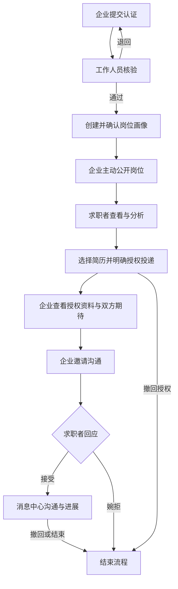

公开岗位、投递授权、接受沟通是三个独立动作。仅在 AI 中分析某个 JD，不会自动投递；企业看到材料后，也不能自动开启普通聊天。

### 3.2 投递状态机

后端状态与按钮权限由 `Hiring.change` 控制；前端隐藏按钮只是界面提示。

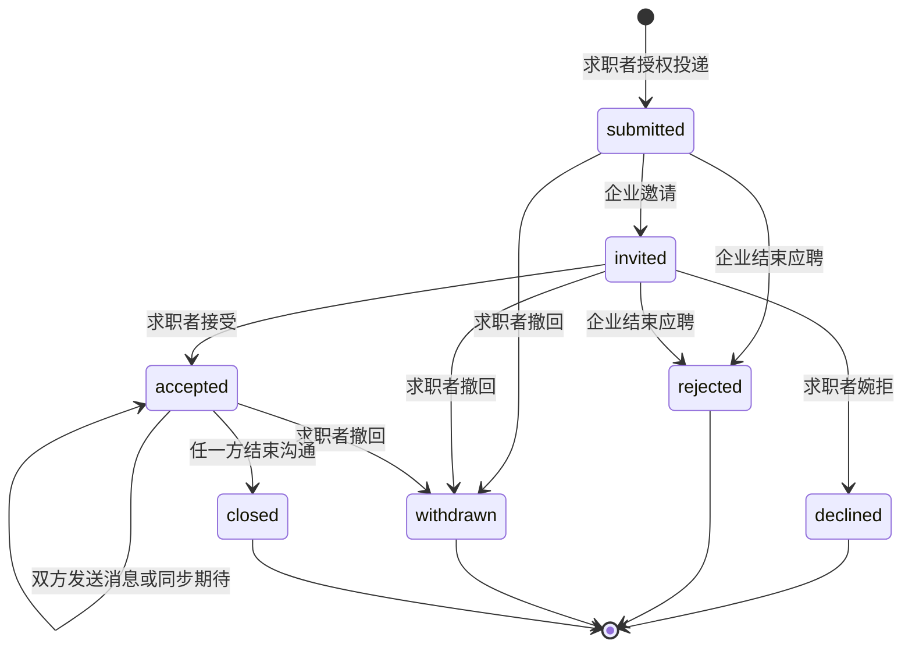

`submitted`、`invited`、`accepted` 阶段允许各自主动同步最新已共享期待。终态禁止继续操作，招聘资料卡和招聘 AI 历史会清除，授权简历及其导入衍生材料不再向企业开放。已下载到企业设备的文件不能由系统远程撤回，这也是授权说明需要清楚表达的实际边界。

### 3.3 求职者 AI 协作流程

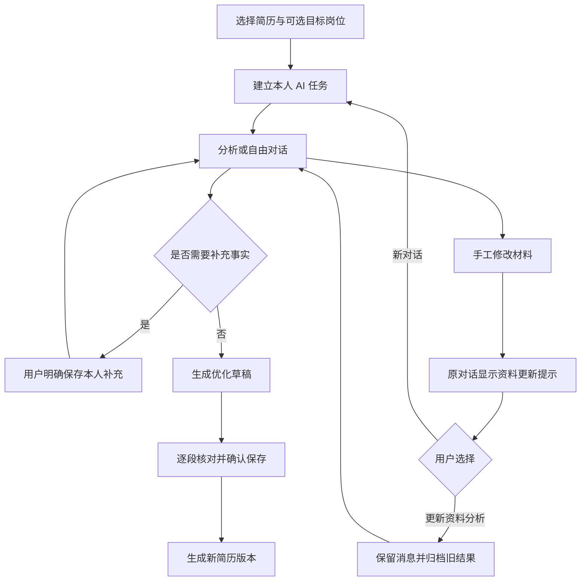

普通聊天文本不会自动变成事实依据；只有用户明确保存的本人补充才进入后续来源。本人陈述不等于第三方真实性核验。

<a id="stack"></a>
## 4. 技术框架与选型作用

版本来自仓库锁文件或 `package.json`，不是对这些软件最新版本的声明。

| 层次 | 技术与当前基线 | 在项目中的作用 | 关键入口 |
| --- | --- | --- | --- |
| 后端运行时 | Python 3.13 | 业务服务、规则、文件解析、模型调用及后台线程任务 | `start.py`、`docker/api.Dockerfile` |
| HTTP 框架 | FastAPI 0.143.0 | 路由、认证依赖、请求校验、错误处理、OpenAPI | `app/main.py` |
| ASGI 服务 | Uvicorn 0.54.0 | 承载 FastAPI；当前 Docker 为单 API 进程 | API Dockerfile |
| 数据契约 | Pydantic 2.14.0 | 输入约束、结构化模型输出、版本和枚举校验；部分高风险输入拒绝额外字段 | `models.py`、双端 AI 模型类 |
| 数据库 | Python `sqlite3` / SQLite，WAL | 账号会话及业务持久化；事务、外键、owner/env 索引 | `auth.py`、`db.py` |
| HTTP 客户端 | HTTPX 0.28.1 | 模型服务和短信服务请求；受限响应读取与总时限 | `model_transport.py`、`sms.py` |
| 文档解析 | pypdf 6.20.0 | 提取可复制文本 PDF 的正文；没有 OCR 识别能力 | `main.py:parse_document` |
| 配置装载 | python-dotenv 1.2.4 | 从根目录 `.env` 读取后端配置 | `settings.py` |
| 前端 | Vue 3.5.43、TypeScript 5.9.3 | 组件化业务页面与接口类型约束 | `frontend/src/` |
| 路由 | Vue Router 4.6.4 | 双端/管理端路由、登录守卫、角色与认证引导 | `frontend/src/main.ts` |
| 构建 | Vite 8.3.4、vue-tsc | 开发代理、热更新、生产打包和 Vue 类型检查 | `frontend/vite.config.ts` |
| 图标与图形 | `@lucide/vue` 1.55.0、Vue/SVG | 一致的图标及代码生成的技术经历结构图 | `RecruiterExperienceGraph.vue` |
| 模型适配 | 自建 AgentGateway + ModelCatalog | 统一提示、协议、模型名单、证据校验、重试与审计 | `agents.py`、`model_catalog.py` |
| 可选检索 | ChromaDB、Sentence Transformers、BGE-M3、BGE reranker | 本地简历分块编码、metadata 隔离及重排；默认关闭 | `requirements-vector.txt`、`retrieval.py` |
| 前端静态服务 | Nginx unprivileged 1.28 镜像 | 提供 SPA、同源 `/api` 反向代理、安全响应头 | `docker/frontend.conf` |
| 交付 | Docker / Docker Compose | 两服务构建、健康检查、资源限制与数据卷 | `docker-compose.yml`、`deploy.sh` |
| 测试 | pytest、FastAPI TestClient、Vitest、Playwright | 规则/API、前端状态/组件、隔离浏览器验证 | `tests/`、前端 `*.test.ts` |

求职者材料助手使用 LangGraph 编排有调用次数和时限约束的工具流程，模型请求仍经过现有网关。其余业务继续使用既有服务流程；当前没有依赖 Celery、Redis 服务或 ORM。业务中提到的 Redis、Docker、FastAPI 等求职者技能，也不能据此认定为平台自身使用的基础设施。

依赖入口：`requirements.txt` 是范围约束，`requirements-runtime-lock.txt` 是运行锁定，`requirements-dev.txt` 引入测试工具，`requirements-lock.txt` 供完整开发安装使用；前端使用 `package-lock.json` 配合 `npm ci`。

<a id="architecture"></a>
## 5. 系统架构与代码组织

### 5.1 逻辑架构

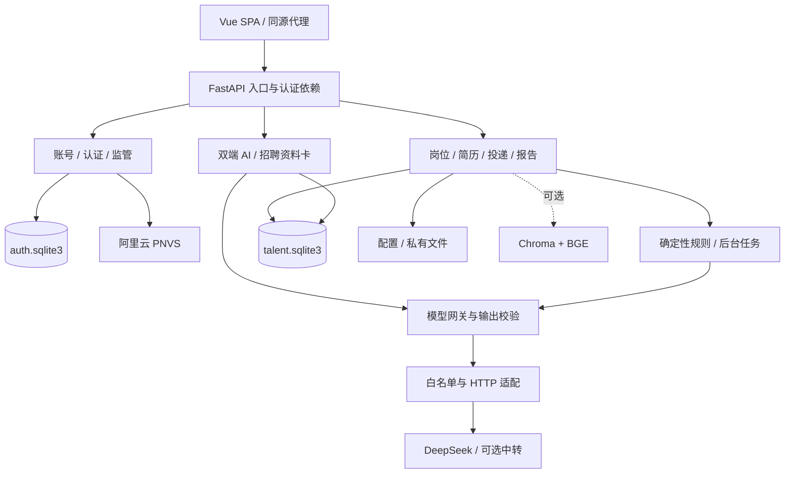

这是一个**模块化单体**：各领域模块在同一 API 进程内协作，使用两个 SQLite 文件及本地文件目录。逻辑模块不等于独立微服务。后台报告和 PDF 解析使用不同线程池。

### 5.2 代码地图

```text
app/
  main.py                    应用工厂、路由、依赖、文件导入、生命周期
  service.py                 核心业务编排、owner 检查、报告与偏好
  models.py                  公共请求和报告数据结构
  deterministic.py           偏好、技能、GPA、汇总和排序规则
  agents.py                  结构化模型网关、JD 和能力证据整理
  model_catalog.py           服务端模型白名单及公开元数据
  model_transport.py         Chat Completions / Responses / SSE 适配
  auth.py / passwords.py     手机号账号、会话、双空间、密码
  sms.py                     阿里云 PNVS 短信发送与核验
  enterprise_verification.py 企业材料与人工审核
  platform_admin.py          账号/岗位监管及跨账号治理
  hiring.py                  投递、授权、邀请、消息、简历导入下载
  ai_workspace.py            求职者任务、补充、草稿、材料版本
  recruiter_review.py        授权投递的个人资料卡
  recruiter_assistant.py     单投递招聘 AI 对话
  assessment_tasks.py        后台能力报告任务及恢复
  db.py / configuration.py   SQLite 业务表、配置资产
  security.py / errors.py    脱敏与领域错误
  retrieval.py / seed.py     可选向量检索、合成示例
frontend/src/
  main.ts / App.vue          路由与应用外壳
  store.ts                   会话范围、API、刷新、异步上下文
  pages/                     各业务页面
  components/                资料卡、图谱、对话、报告、授权弹窗等
  *-workspace.css 等         基础、导航、视觉、交互及页面样式
config/                      随代码交付的默认版本标准
docs/upstream/               PRD 与上游量规
tests/                       Python 规则/API 与浏览器验收
scripts/                     账号维护、评测、合成数据及冒烟验证
docker/                      API/Web Dockerfile 和 Nginx 配置
web/                         已归档的 Streamlit 页面参考
presentation/、in-sync/      其他展示或历史产物，不在默认启动链路
data/                        运行数据与私有文件，不提交 Git
artifacts/                   测试、截图和临时验证产物，不提交 Git
```

### 5.3 模块协作原则

路由负责认证和输入输出，领域模块负责状态及权限语义，确定性模块负责可复现计算，模型网关负责受约束的自然语言理解。网关不直接导入数据库或获得业务操作工具；权限不能依靠提示词实现。

新增流程应沿用 `create_app(settings)` 注入独立配置，方便在临时 `DATA_DIR` 中测试。不要在测试中直接复用开发者业务库。

<a id="data"></a>
## 6. 数据模型、版本与授权快照

### 6.1 存储布局

| 位置 | 内容 | 维护含义 |
| --- | --- | --- |
| `DATA_DIR/talent.sqlite3` | 岗位、简历、投递、报告、偏好、AI 任务、审计等 18 张业务表 | 通用字段加 JSON payload，并为明确关系建立外键 |
| `DATA_DIR/auth.sqlite3` | accounts、account_workspaces、sessions、codes、limits、enterprise_submissions、enterprise_review_events、platform_admin_events | 认证与监管数据分库；不是与业务库跨库原子事务 |
| `DATA_DIR/raw_files/` | 导入前原始文字，按 UUID 保存的 TXT | 并非原始上传 PDF；不得由静态目录公开 |
| `DATA_DIR/enterprise_credentials/` | 企业营业执照、授权证明 | 通过受控下载接口访问 |
| `DATA_DIR/config/` | 配置修订、标准包、活动 manifest | 优先于仓库默认配置；重建镜像不应丢失 |
| `DATA_DIR/chroma/` | 可选向量索引 | 是可重建的衍生数据；需同步 owner/env/origin |
| `DATA_DIR/backups/`、`DATA_DIR/runtime/` | 维护备份、启动日志 | 备份本身包含敏感数据，需按业务数据保管 |

### 6.2 主要实体关系

下面的图只展示维护时最重要的关系。`owner` 到认证空间的对应关系由应用校验；跨库虚线为逻辑关联，不是 SQL 外键。

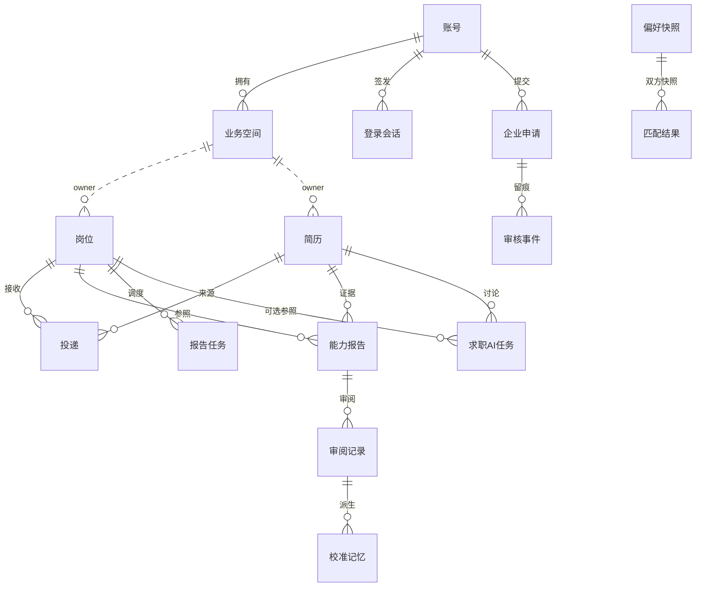

其余业务表：`batches`、`fit_reports`、`role_benchmarks`、`job_comparison_runs`、`audit_logs`。投递消息、事件、阅读游标、招聘资料卡和招聘对话目前位于 `applications.payload`，不是独立消息表；报告任务的 `resume_ids` 是 payload 中的数组，也不是逐项 SQL 外键。

### 6.3 通用业务字段

| 字段 | 说明 | 约束 |
| --- | --- | --- |
| `id` | UUID 主键 | 客户端不能凭 ID 推断访问权 |
| `owner` | 业务空间 actor，如 `candidate:<uuid>` 或 `enterprise:<uuid>` | 普通列表通常需同时按 owner 和 env 过滤 |
| `env` | `dev / demo / prod` | 不跨环境读写；切换环境不等于搬迁资料 |
| `data_origin` | `synthetic / real` | 演示数据清理和基准来源的依据，不能把合成材料说成真实样本 |
| `created_at` | 创建时间 | 业务记录使用 UTC ISO 时间；认证库部分时间为 Unix 秒 |
| `payload` | JSON 业务字段 | `Database.update` 仅更新 JSON；SQL 外键列变更须显式 SQL |

`Database.get` 自动限定 env，**不自动保证 owner**。新接口必须继续通过 `owned`、`active_resume`、`Hiring.owned/shared_resume` 等领域访问函数，不能裸读后直接返回。

### 6.4 三类快照纪律

**偏好快照**：每次保存新增 `preference_submissions`；`match_results` 引用企业和求职者各自的 submission ID、维度版本及规则版本。新期待不会悄悄改变旧结果。有效投递读取已授权期待版本，只有各方主动同步时才更新共享快照。

**投递快照**：`applications` 保存简历正文/名称、岗位原文/版本、可选期待、授权时间及留言。招聘资料卡、对话、导入和下载均从这次授权材料出发。求职者以后修改私人简历，企业不会自动读到新版本。

**报告快照**：报告保存岗位画像、Brief、量规、优先级、标准包、模型及 prompt 版本。配置升级和重新确认岗位，不回写旧报告。

简历软删除只停止新工作使用，不等于撤回已有投递；历史任务和已授权快照按原规则保留。终止共享则通过授权链阻止企业继续读取衍生资料。当前没有完整的数据保留期限及物理清除产品流程，见第 15 节。

<a id="ai"></a>
## 7. AI 实现与确定性规则

### 7.1 “Agent”在当前代码中的含义

系统采用受限任务编排：服务端选择资料和工具边界，模型完成结构化证据整理，代码校验后决定是否保存。求职者材料助手通过 LangGraph 在当前简历、已确认补充和所选岗位范围内读取材料、定位经历并准备带引用的草稿，用户确认后才保存新版本。第二阶段支持流式回答、查询授权可见岗位、发起及读取现有契合度后台任务，以及改写高亮和逐段采纳。第三阶段招聘材料助手复用调度与流式通道，在当前授权投递范围读取简历和岗位、检索经历并准备面试追问，招聘方选择确认后才保存提纲。详见[第一阶段](求职者材料Agent第一阶段.md)、[第二阶段与流式协作](求职者Agent第二阶段与流式协作.md)及[招聘 Agent 第三阶段](招聘Agent第三阶段.md)。工具不能任意访问全库、操作账号或执行代码；当前没有多 Agent 自主协商框架。

| 能力 | 实际实现 | 是否调用 LLM |
| --- | --- | --- |
| JD 画像提取 | 网关抽取技能、方向、学历和逐字引用；demo 使用本地解析 | live/deepseek 模式调用 |
| 能力报告 D1/D3/D5 | 专业相关性、项目经验、实践经历的证据与锚点 | live/deepseek 模式调用，固定 DeepSeek |
| D2 学业、D4 技能汇总 | 成绩换算、技能相对要求关系和序数下中位数 | 确定性代码 |
| 偏好匹配、排序键、预算估算 | 配置驱动的固定规则 | 确定性代码 |
| 初筛 | 当前岗位技能的行为证据与明确规则标记 | 确定性代码，所有简历保留 |
| 报告缺口追问 | 从已确认报告缺口生成验证问题模板 | 当前为模板，不冒称自由模型生成 |
| 求职者 AI | 分析、对话、草稿、确认保存 | 真实模型，按任务选模型 |
| 招聘资料卡/AI 对话 | 精华、经历业务关联、面试追问 | 真实模型；资料卡默认 DeepSeek，招聘对话固定 DeepSeek |
| JD 诊断与标准自检 | 矛盾、基准、可评性检查及内部实验 | 以对应服务/规则实现为准，不代表全面语义审查 |

默认 `LLM_MODE=demo` 时，原有画像/报告走本地规则。独立双端 AI 工作区及资料卡的真实生成需要模型启用且有密钥，不会在未配置时伪造模型回答。

### 7.2 输出可信链

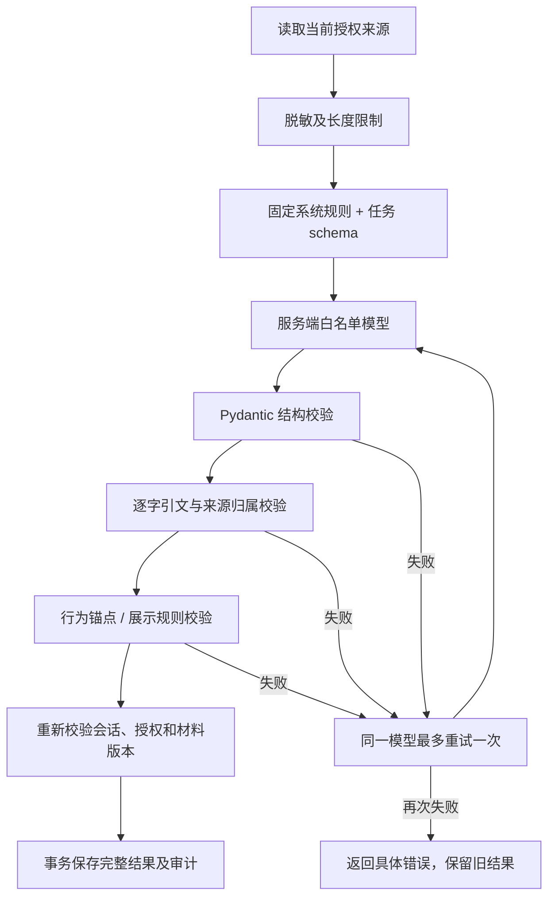

模型请求失败也最多重试一次。图中重试节点表示单次重试额度，不是无限循环。资料卡和对话保存前还会在领域层再次校验，避免适配器替换后绕过规则。

逐字引用能验证“引文来自材料”，不能单独证明“解释一定正确”或“经历真实”；语义推断质量仍需人工评测和审阅。

### 7.3 量规与偏好计算

- 内部能力维度为 D1 专业相关性、D2 学业表现、D3 项目经验、D4 技能证据、D5 实践经历。B1～B5 是序数关系，`insufficient` 表示依据不足，不能当成 B1。
- 技能 L0～L4 表示原文支持的行为等级；L0 不入档。L 与岗位要求 R 的差值依次映射相对关系，公式在 `skill_tier` 中实现；D4 只汇总硬性技能，加分项不参与。
- D1/D3/D5 跨档需相邻并给出原因；D4 的部分未知情况按可能下中位数范围处理，是特定规则例外。
- 排序键依次比较相符及以上维度数量、优先级逐维结果、证据充分维度数量。同键并列，不算综合分；区间使用保守一侧，缺失使用内部哨兵值。
- 偏好为高/中/低/无法判断四态。技术方向按相同或相关关系判断，其他维度按配置选项距离判断；三项必填中任一缺失则整体无法判断，选填单独展示。

企业侧应使用“与岗位要求的关系/差距”等措辞。后台“不得猜测”等执行约束不应进入面向用户的理由文本；量规原文仍作为维护资产保留。

### 7.4 模型路由和协议

`ModelCatalog` 维护允许选择的模型 ID。浏览器只能提交 ID，不能指定地址、API 密钥或工具参数。模型名称为服务端配置/提供方标识，不是本项目对底层模型身份的独立认证。

| 场景 | 当前路由 |
| --- | --- |
| 新求职者 AI 任务 | 采用服务器默认 ID，可在该任务内选择已配置模型；历史保留 provenance |
| 能力评估及复用该评估的求职者岗位对照 | 显式 `model_id='deepseek'` |
| 后台能力报告任务 | 固定记录 DeepSeek 官方模型 |
| 招聘 AI 对话 | 固定 DeepSeek 官方模型 |
| 招聘资料卡 | 默认 DeepSeek；API 仍接受白名单 `model_id`，不是硬编码禁止其他模型 |
| JD 解析 | 网关默认模型；改变服务器默认 ID 会影响此类未显式指定 ID 的调用 |

DeepSeek 使用 Chat Completions；预置中转使用 Responses，支持 SSE，设置 `store=false`。SSE 由后端收集并完成校验后再返回前端，不表示浏览器逐 token 展示。

每次模型 HTTP 请求默认限制 90 秒，求职者工作区回合显式设置为 60 秒。响应成功正文上限 2,000,000 字节，错误正文读取上限 16,384 字节；总时限通过可取消的异步接收实现，避免保活空白持续刷新读取超时。两次尝试及服务处理意味着部分业务操作可能接近 180 秒以上，不能把“90 秒”写成所有业务总耗时上限。

每次尝试记录 agent、模型/提供商/协议、prompt 版本、输入哈希、时长、token、费用估算和受控错误代码。原始供应商错误正文不直接进入提示或审计。费用预算按**当前环境**累计已记录调用估算，不是供应商账单；并发和未配置单价会限制其精确控费能力。

<a id="interfaces"></a>
## 8. 接口约定与关键时序

### 8.1 通用接口约定

- 浏览器请求 `/api/...`；Vite/Nginx 去掉 `/api` 后转至 FastAPI。直接访问后端时路径不带 `/api`。
- 浏览器使用同源 Cookie；`X-Session-Scope: user|admin` 选择会话范围，写请求附 `X-CSRF-Token`。后端仍验证范围、角色和对象权限。
- 领域错误格式为 `{"detail":{"code":"错误码","message":"可展示说明"}}`；输入格式错误还会包含 `fields`。前端不应靠中文错误文案判断分支。
- 409 通常表示版本、状态或幂等冲突；429 表示限流/预算/并发；502/503 表示模型请求或服务未就绪。404 也用于隐藏无权访问的资源存在性。
- 关键写入使用 `expected_version`；已有 `request_id` 的流程复用同一编号恢复不确定结果。求职者普通 AI 回合当前主要使用版本和运行锁，不能假定所有 POST 都有全局幂等键。

### 8.2 授权投递与企业简历导入

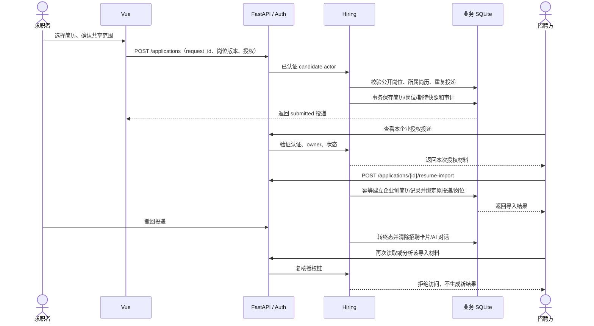

### 8.3 后台能力报告

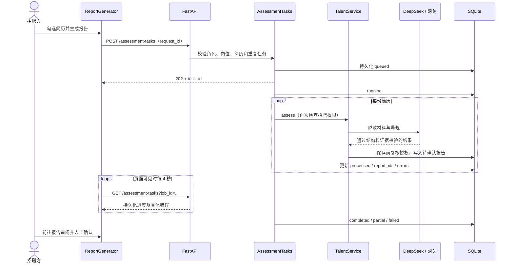

任务最多两个同时执行，执行及排队合计最多八个。服务重启后将遗留 queued/running 标为 `interrupted`，不自动重放付费请求；已经生成的报告保留。进度持久化不等于分布式任务队列。

### 8.4 招聘 AI 对话

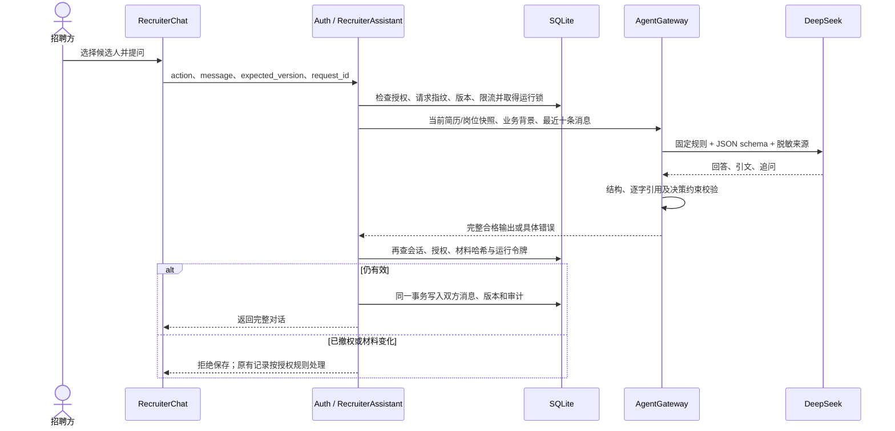

招聘对话版本独立于投递进展版本，避免发消息和 AI 提问互相污染。该 AI 接口不执行邀请、聊天发送或权限变更；这些动作由独立业务接口校验。

### 8.5 常用请求示例

以下为结构示例，所有 UUID 需由实际列表结果或客户端生成，不能直接复制占位符执行。

```json
{
  "job_id": "岗位UUID",
  "resume_ids": ["招聘空间简历UUID"],
  "request_id": "同一次提交复用的UUID"
}
```

上例用于 `POST /assessment-tasks`。招聘 AI 的 `POST /applications/{id}/recruiter-assistant/turns`：

```json
{
  "action": "interview",
  "message": "",
  "business_context": "需要进一步了解接口维护和部署排障经历",
  "expected_version": 0,
  "request_id": "客户端生成的UUID"
}
```

`expected_version` 应使用服务端刚返回的版本，不能固定为示例值。完整路径、方法和权限依赖见附录；字段精确定义可查本地 `/docs` 或 `/openapi.json`。

<a id="frontend"></a>
## 9. 前端结构与交互规范

### 9.1 状态与路由

当前使用 Vue 响应式共享状态 `store.ts`，未引入 Pinia/Vuex。页面通过统一 `api` 发请求；路由守卫初始化身份、选择 user/admin 范围，检查工作空间与企业认证。修改全局共享状态需考虑切换角色、跨标签页以及未完成请求。

`clearWorkspace` 增加 `epoch` 并中止现有 AbortController。API 回来时比较 epoch，页面内再比较请求序列/当前选择，防止旧账号、旧候选人或旧搜索结果回填。写操作超时不代表服务器未完成，前端应先查询结果，而不是直接换编号再次提交。

### 9.2 工作区布局

求职者 AI 提供对话/工作台及双区呈现等既有模式；招聘 AI 使用统一双栏：左侧授权投递和历史筛选，右侧当前候选人的对话、资料卡/技术图谱、授权原文。模型和范围提示保持紧凑，业务背景按需展开，快捷任务置于输入框附近。

桌面由工作区容器占据可用视口，列表与正文各自滚动，输入区保持可到达；980px 以下招聘工作区使用候选人切换视图，短于 580px 的横屏允许整页滚动。调整滚动布局时，要同时设置 flex/grid 子项的 `min-height: 0`、明确滚动所有者，避免父子层一起截断内容。

### 9.3 操作和信息必须可辨

| 类型 | 统一表达 | 实现来源 |
| --- | --- | --- |
| 主要操作 | 实心紫色、白字、明确点击区域 | `interaction-system.css` |
| 次要操作 | 边框按钮，有 hover/focus 反馈 | 同上 |
| 删除/撤回等 | 红色语义、明确说明与确认交互 | 业务组件 + 交互样式 |
| 禁用操作 | 灰底灰字、虚线边框、禁止光标 | 不能只降低整块透明度 |
| 来源/版本/提示 | 中性文字，不伪装成按钮 | 视觉规范 |
| 状态/技能标签 | 紧凑平面标记，保留文字 | 不只依赖颜色 |
| 编辑表单/引用原文 | 独立分组、标题、边界及不同底色 | `JobRequirements`、页面组件 |

样式加载顺序在 `main.ts`：基础 → 求职 AI → 外壳 → 视觉 → 消息 → 交互 → 招聘工作区。修改新样式前应检查此前层叠规则，不用大量全局 `!important` 修补局部布局。

交互动画支持 `prefers-reduced-motion: reduce`；弹窗需保持键盘焦点、Escape 退出与关闭后焦点恢复。提示符即时显示内容，避免 tooltip 被滚动容器裁剪；手机和键盘使用也需能获得说明。

<a id="security"></a>
## 10. 身份认证、隔离与安全边界

### 10.1 会话与企业准入

- 手机号验证码用于注册、登录及重设密码，用途分开；验证码五分钟有效，发送冷却 60 秒，最多五次核验尝试，并有持久化限流。
- 密码使用带盐 scrypt（N=32768、r=8、p=3），并发内存分配受限；账号库不保存明文密码。重设密码撤销该账号旧会话。
- Cookie 为 HttpOnly、SameSite=Strict，12 小时有效；`APP_ENV=prod` 时 Secure，需要 HTTPS。
- 普通与管理端分别使用 `tongpin_session`、`tongpin_admin_session`。数据库还保存 session_scope，改 Cookie 名或伪造头不能升级权限。
- 同一普通业务会话切换求职/招聘会旋转令牌和 CSRF，前端清理旧状态；同一 user 范围的多个标签页同步身份变化。管理端采用独立频道，不随普通退出而退出。
- 工作人员权限由本机维护工具授予，没有公开的管理员自助注册或默认密码。企业代码格式和附件类型通过不等于认证通过，仍须人工核验。

### 10.2 授权检查位置

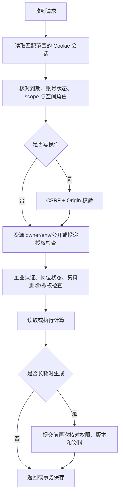

### 10.3 模型和文件安全

脱敏在导入及 AI 来源组装时执行，覆盖邮箱、手机号、身份信息和部分敏感属性；这是规则过滤，不应宣称能识别所有个人信息。原始文字与企业证明仍为私有数据，受接口权限控制，不放到 `frontend/public`。

模型只拿当前任务的有限材料。简历/JD/对话中的“修改权限、读取他人资料”等内容按不可信输入处理；后端没有向模型提供这些工具。提示词负责约束输出，真正的权限隔离依赖认证和领域访问检查。

下载返回 attachment、no-store、nosniff；API 响应禁止缓存。Nginx 配置 CSP、禁止被页面嵌入及同源连接限制。所有 API 密钥留在后端，禁止放入 `VITE_*` 或前端存储。

<a id="problems"></a>
## 11. 开发过程中主要问题与解决方案

以下问题来自仓库修复记录及对应实现/测试，不是推测性的事故复盘。历史测试通过只说明当时覆盖的契约，不能替代真实模型或生产环境验证。

| 主要问题 | 原因及表现 | 当前解决机制 | 代码与验证依据 |
| --- | --- | --- | --- |
| 页面仍有填表感，按钮、标签和说明难分辨 | 同色文字和弱分组让操作层级模糊 | 区分主要/次要/危险/禁用状态；岗位画像默认阅读，明确进入编辑；原文和表单分区 | `interaction-system.css`、`JobRequirements.vue`；[视觉规范](前端视觉与交互规范.md)、`browser_interaction_refresh.py` |
| AI 工作区拥挤、输入区被挤掉、无法滚动 | 标题和多个工具栏占位，容器高度/滚动职责不一致 | 工作区按视口组织，内部分区滚动，输入区固定；招聘双栏和手机候选人切换；短横屏保留页面滚动 | `recruiter-workspace.css`、`RecruiterAI.vue`、`RecruiterChat.vue`；`browser_recruiter_layout.py` |
| 只有私人 JD 对照，没有双向求职通道 | 分析结果与企业岗位、候选人授权没有业务关联 | 增加认证公开岗位→明确授权投递→邀请→接受→站内沟通状态机 | `hiring.py`、`Applications.vue`、`Messages.vue`；`test_hiring.py`、`test_message_center.py` |
| 招聘端看不到投递简历，导入仅支持本地 | 个人材料与企业材料正确隔离，但缺少受控桥梁 | 从有效投递快照一键导入，绑定来源投递/岗位，幂等复用；开放授权文本下载 | `Hiring.import_resume/download_resume`；`test_applicant_resume_import.py` |
| AI 对照失败仅显示笼统错误 | JSON、引文、技能锚点和供应商错误混在同一提示里 | 按请求/schema/证据阶段归因；引文必须连续逐字，重试仅加入服务端修正词；失败不保存新半成品 | `AgentGateway.call`；`test_agents.py` |
| 中转模型要求流式请求，分析报 HTTP 400 | 中转分组只接受 Responses SSE | 适配 Responses SSE，默认启用 relay stream；受控记录 `stream_required`；不把流传输误当成跳过校验 | `model_transport.py`、`model_catalog.py`；`test_model_switching.py`、[模型说明](模型选择与切换.md) |
| 能力报告请求超时，用户无法判断是否完成 | 生成批量报告与单个浏览器长请求绑定 | POST 短请求返回 202，后台任务入库，前端每四秒查询；固定 DeepSeek；部分失败逐项展示 | `assessment_tasks.py`、`ReportGenerator.vue`；`test_assessment_tasks.py` |
| 模型不断返回保活空白导致读取迟迟不结束 | 普通 read timeout 被每个 chunk 重置 | 限制整次 HTTP 真实耗时和响应体，覆盖两种协议及 SSE；最多同模型再试一次 | `ModelClient`；`test_model_deadline.py` |
| 修改资料后自动跳新对话或旧结论混入新分析 | 材料版本与聊天记录缺少清楚关联 | 暂存新材料，原对话提示用户选择；更新时归档旧结果、增加 material_epoch，排除旧材料上下文 | `AIWorkspace.edit_material/resolve_materials/turn`；`test_ai_material_history.py` |
| 管理端登录覆盖普通账号，切换角色迟到响应污染页面 | 共用 Cookie/通知范围或未隔离异步回填 | 双 Cookie + 持久化 scope + 独立 BroadcastChannel；角色切换旋转令牌、epoch 与 AbortController | `auth.py`、`store.ts`；`test_session_scopes.py`、`store.scopes.test.ts` |
| 旧对照能看到未来保存的期待 | 授权读取最新记录，未绑定具体版本 | 明确共享某次 submission；主动同步才更新；撤回后不可再读新的期待 | `TalentService.run_match`、`Hiring.preference/change`；`test_acceptance_fixes.py` |
| AI 输出“缺少就是不会”等结论或后台约束话术 | 关键词匹配、缺失证据与低能力混淆 | insufficient 单独输出，行为上限/来源归属校验；内部约束留在 prompt，展示理由只谈材料事实与缺口 | `deterministic.py`、`agents.py`、双端 AI 校验；`test_alignment.py` |
| 脱敏遗漏独立行/分隔行个人属性 | 仅识别固定“字段：值”格式 | 扩展独立性别/年龄、逗号/竖线及带空格/连字符手机号；组装 AI 来源时再次过滤 | `security.redact`；`test_acceptance_fixes.py` |
| PDF 解析阻塞 API，超时后仍可能产生迟到材料 | 重解析在请求执行链中运行 | 独立两线程及两槽位、20 秒等待、50 页/50000 字限制；解析完成后才入库，超时不写入 | `main.py:parse_upload`；PDF 超时及并发回归 |
| 重复技能把岗位基准样本虚增 | 按条目计数而不是按独立岗位计数 | 画像拒绝大小写归一重复技能；每岗每技能只取一次，至少 20 个独立岗位，保存采样凭据；旧无凭据基准停用 | `JobProfile.unique_requirements`、`build_benchmark`；`test_acceptance_fixes.py` |
| 大量投递/消息遗漏，旧记录搜索不到 | 固定读取上限和仅当前页统计 | 服务端分页、全历史搜索、独立未读总数；查询切换丢弃迟到结果 | `Hiring.page/unread_total`；超过 1000 条的专项回归 |
| 企业撤销认证按钮似乎没有反应 | 审核依据校验与反馈不清晰 | 审核接口要求至少五字依据，前端校验/错误反馈；成功后撤销企业会话并停止岗位公开 | `EnterpriseReview`、`EnterpriseVerification.vue`；`test_enterprise_verification.py` |
| 简历只能导入不能删除 | 缺少材料库生命周期入口 | 所有者可软删除，审计留痕；停止新分析，保留历史快照，不静默撤回已有投递 | `TalentService.delete_resume`；`test_resume_deletion.py` |
| 容器配置保存与镜像默认文件冲突 | 修改只读交付文件不能可靠持久化 | 默认配置置于 `config/`，修订/标准包写入数据卷并原子替换；先整包校验再激活 | `Configuration.save/import_pack`；`test_system.py` |

PDF 超时不能强杀 Python 中正在解析的线程，槽位会占用至真实任务结束。当前措施保证请求隔离与不迟到入库；若需严格回收恶意/极慢解析，应改独立进程或外部解析服务。

<a id="development"></a>
## 12. 本地开发与配置

### 12.1 最短启动路径

推荐 Python 3.13，Node.js 22.12 或更新的受支持 LTS。前端 engines 的实际允许范围为 `^20.19.0 || >=22.12.0`。

在项目根目录运行：

```powershell
python start.py --install
```

也可双击 `一键启动.bat`。默认后端 8000、前端 8501；自动模式遇端口占用会寻找空闲端口，实际地址看启动输出。指定固定端口发生冲突会明确报错：

```powershell
.\一键启动.bat --api-port 8003 --web-port 8503
```

保留启动终端，Ctrl+C 停止本次两个进程。日志见 `data/runtime`。手工启动时，在两个终端分别执行：

```powershell
# 终端一：根目录，依赖已安装
.\.venv\Scripts\python.exe -m uvicorn app.main:app --host 127.0.0.1 --port 8000
```

```powershell
# 终端二
cd frontend
npm ci
$env:VITE_API_PROXY_TARGET = "http://127.0.0.1:8000"
npm run dev -- --port 8501
```

`http://127.0.0.1:8000/docs` 为后端交互文档，`/health` 为健康状态。主流程不需要启动 Streamlit，也不需要启动 Redis/Chroma 容器。

### 12.2 配置分组

首次建立 `.env` 时可从 `.env.example` 复制，已有文件不要覆盖。下面仅列名称和用途，不包含本机真实值。

| 配置 | 用途与默认行为 |
| --- | --- |
| `APP_ENV`、`DATA_DIR`、`AUTO_SEED` | 环境、数据路径、启动示例装载；默认 demo、根目录 data、不自动装载 |
| `LLM_MODE` | demo 为本地规则；deepseek/live 启用已配置真实模型 |
| `DEEPSEEK_API_KEY/BASE_URL/MODEL` | DeepSeek 官方连接；模型 ID 由部署者实际配置 |
| `LLM_DEFAULT_MODEL_ID` | 新任务及未显式指定模型的调用默认值，建议保持 deepseek |
| `DEEPSEEK_PRO_*`、`RELAY_*` | 额外模型、地址、流式设置和估算单价；中转为可选 |
| `LLM_PROFILES_JSON` | 服务端扩展白名单；限制协议、HTTPS 地址和密钥环境变量名 |
| `COST_BUDGET_CNY`、`INPUT/OUTPUT_PRICE_PER_MILLION` | 当前环境预算及基础模型估算单价；示例不是官方报价 |
| `VECTOR_ENABLED` | 默认 false；开启前安装扩展依赖并预下载权重 |
| `ALIBABA_CLOUD_ACCESS_KEY_ID/SECRET`、`ALIBABA_SMS_*` | PNVS 发送/核验参数；同一方案名须一致 |
| `VITE_API_PROXY_TARGET` | 仅开发代理目的地址；不能用于保存 AI 密钥 |

修改模型、短信或数据库配置后重启后端；只修改前端开发代理地址需重启 Vite。服务健康和模型配置齐全不代表短信实际送达或模型质量通过。

### 12.3 管理员和合成数据

工作人员先注册手机号，再由可信服务器维护者本机授权：

```powershell
.\.venv\Scripts\python.exe scripts/manage_accounts.py promote-admin --phone 工作人员手机号
```

未注册工作人员可使用 `provision-admin` 预置，再由本人短信验证并设置密码。该工具会撤销旧会话，不设置公共默认密码；操作前按脚本说明停止服务并保留备份。`claim-legacy` 是显式历史演示材料迁移工具，不应在新注册时自动执行。

合成招聘样例使用 `scripts/seed_recruiter_examples.py`，运行前先查看脚本参数和目标环境，不能把测试企业认证标记用作真实企业真实性证明。单元测试使用独立 FakeSMS，不向真实手机发送短信。

<a id="testing"></a>
## 13. 测试与质量验证

### 13.1 分层验证

| 层次 | 重点 | 代表文件 |
| --- | --- | --- |
| 规则单元 | 偏好可复现、档位边界、缺失与区间、等级锚点、呈现措辞 | `test_alignment.py`、`test_system.py` |
| 业务与权限 | owner/env、双会话、认证撤销、快照共享、下载导入、终态 | `test_auth_isolation.py`、`test_hiring.py`、`test_session_scopes.py` |
| AI 契约 | 模型选择、结构/引文、行为上限、旧结果保留、超时、撤权竞态 | `test_agents.py`、`test_model_deadline.py`、双端 AI 测试 |
| 任务与故障 | 短请求、幂等、重启中断、部分结果、撤权不落库 | `test_assessment_tasks.py` |
| 前端状态/组件 | 异步回填、角色切换、授权弹窗、聊天、任务恢复、图谱 | 前端 `*.test.ts` |
| 浏览器 | 完整交互、滚动、移动端、焦点、启用/禁用识别 | `browser_interaction_refresh.py`、`browser_recruiter_assistant.py`、`browser_recruiter_layout.py` |
| 模型质量 | 人工标注一致性、引用覆盖、重复稳定性、baseline | `scripts/evaluate.py` |

建议命令：

```powershell
.\.venv\Scripts\python.exe -m pytest -q
.\.venv\Scripts\python.exe -m pytest tests/test_assessment_tasks.py tests/test_model_deadline.py -q
```

```powershell
cd frontend
npm run test
npm run build
```

测试默认将临时库放入 `artifacts/pytest-default/<进程号>`，并隔离模型环境变量。pytest 收集或导入应用可能在默认数据目录创建/检查表结构，因此新环境首次验证仍应显式指定临时 `DATA_DIR`，不能将测试作为操作生产库的方式。

浏览器脚本依赖配套隔离服务与端口，详见[招聘 AI 文档](招聘AI工作区.md)。不要让预览服务占用实际开发服务端口，也不要把 FakeSMS 配入正式服务。

### 13.2 已有验证记录与本次文档核对

- 2026-10-14 问题修复记录包含当时的 295 项全量后端通过及后续专项复测；这是历史结果，不代表当前所有后续变更已经全量复测。
- 2026-10-15 招聘 AI 记录包含相关后端 52 项、前端 78 项、类型检查/构建及隔离浏览器验证通过。招聘工作区布局覆盖桌面、手机和短横屏；全站交互记录覆盖 59 个页面/视口组合。
- 本次文档编写对当前测试进行了收集，收集到 **339 项后端测试**。收集成功不等于执行通过；本次未重新执行整个业务测试集、付费模型请求、真实短信或生产部署。
- 文档图表和代码/路径索引的专门校验结果见[文档校验记录](开发文档校验记录.md)。

### 13.3 模型效果评测与工程测试分开

至少准备 20 对独立标注的简历/JD JSONL，逐步扩至目标规模。执行：

```powershell
.\.venv\Scripts\python.exe scripts/evaluate.py 私有标注集.jsonl
# --live 才调用真实模型并产生费用
```

报告包含数据集哈希、量规、模式、样本/失败数量、重复一致性和成本。不能以单元测试通过或一次 DeepSeek 冒烟，宣称已达到 PRD 的初筛一致率、准确率或公平性目标。当前初筛是规则实现，baseline 差异也须按真实实现解释。

<a id="operations"></a>
## 14. 部署、备份与运行维护

### 14.1 部署结构

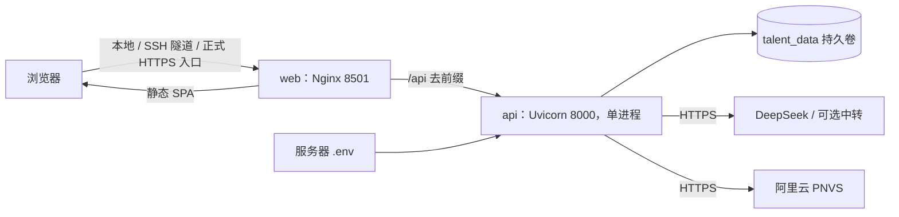

Compose 仅定义 `api`、`web` 两个服务。默认端口绑定 `127.0.0.1`，不是公网监听。API 3 CPU/6 GB、Web 1 CPU/1 GB 为 Compose 配置上限，不代表实测容量；可选模型权重与向量检索另需资源评估。

Linux 初次部署可参考：

```bash
# 已有 .env 时不要覆盖
cp .env.example .env
chmod 600 .env
docker compose config --quiet
docker compose up --build -d --wait
docker compose ps
docker compose logs --tail 100 api web
```

更新已有部署可使用 `deploy.sh`：校验 Compose，停止 API/Web 后备份现有数据卷，再构建启动。脚本没有完整的失败自动回滚编排。正式 `APP_ENV=prod` 应通过已配置的 HTTPS 入口访问；仓库默认 Compose 不自动申请证书、配置域名或开放公网端口。

Nginx 中 `/api` 的 4200 秒代理等待是现有配置，不是业务调用允许无限等待的理由；后台任务和网关总时限仍是主要保护。扩展部署时应统一浏览器、反向代理、API 与任务的超时策略。

### 14.2 备份与恢复纪律

需要作为同一恢复集合保管：两份 SQLite、WAL/SHM（若有）、私有原文和企业证明、运行配置及可选索引。只备份 `talent.sqlite3` 无法恢复账号、授权审核和文件。

1. **备份前**：安排暂停写入/停止服务，记录代码版本、APP_ENV、配置和数据位置；确认真实使用的 Compose 项目名与卷名。
2. **制作备份**：优先使用已有停服卷备份或 SQLite backup API，避免直接复制仍在写入的单个数据库文件；备份 `.env` 时使用受控加密存储。
3. **恢复演练**：先恢复到独立目录/独立卷，不能直接覆盖正在工作的数据。执行 `PRAGMA integrity_check` 和 `PRAGMA foreign_key_check`，核对账号、岗位、投递、快照及私有附件。
4. **业务验证**：检查登录/双空间、授权可见性、配置版本、历史消息与任务；所有外部短信/模型调用保持受控。向量索引可从有效材料重建。
5. **正式切换**：确认演练可用后在维护窗口停服切换，保留切换前数据以便回退，启动后复核 `/health`、前端和关键授权读取。

当前仓库有升级备份工具，没有证据证明正式环境已完成恢复演练或确定 RPO/RTO，应由部署团队补充实测。

### 14.3 常见故障排查

| 表现 | 优先检查 | 处理路径 |
| --- | --- | --- |
| 前端打不开或连不上后端 | 启动终端实际端口、`data/runtime`、Vite proxy、API `/health` | 区分端口占用、依赖安装和代理配置；不要只刷新页面 |
| 管理端/普通端身份混淆 | 路由、Cookie 名、X-Session-Scope、BroadcastChannel | 从对应登录入口重登；不要复制令牌或在前端硬改 role |
| 招聘入口 403/岗位不可见 | 账号状态、企业认证、画像确认、published、平台下架 | 按缺失状态处理；认证撤销后旧 published=true 也不应公开 |
| 报告长时间生成 | task 状态/错误、模型调用审计、预算、DeepSeek 配置 | 先读任务进度；重启后的 interrupted 不自动重跑；只重提未完成材料 |
| 资料卡/对话无结果 | 模型可用性、超时、引文失败、授权是否结束 | 保留旧结果，查看受控错误；不放宽证据规则来掩盖失败 |
| 中转 HTTP 400 stream_required | `RELAY_RESPONSES_STREAM` 与服务端已加载配置 | 启用适配并重启；报告仍优先官方 DeepSeek |
| 修改材料后仍看旧分析 | 是否选择更新、材料 epoch、缓存或迟到响应 | 按资料更新提示明确处理；不要覆盖历史快照 |
| PDF 导入失败 | 是否扫描件、页数/大小/字符数、20 秒限制、槽位 | 转 TXT 或人工录入；不自动宣称 OCR 已完成 |
| 无法读授权简历 | 是否当前企业、原岗位、投递终态/撤权、账号/企业暂停 | 若授权结束，应保持拒绝；不能改 owner 绕过 |
| 短信发送失败 | `.env` 完整性、PNVS 方案/模板/签名、限流、网络 | 测试时用独立 FakeSMS；真实送达另行验证，不记录验证码 |
| 配置保存后未按预期生效 | `DATA_DIR/config` 修订、active_pack、版本及读取优先级 | 从同一标准资产读取；不要只改仓库默认文件 |

<a id="limits"></a>
## 15. 现有限制与后续演进

### 15.1 当前边界

- **任务进程**：后台队列在 API 进程内，SQLite 保存任务状态；不支持多个 Uvicorn worker 共享队列或服务重启后自动续跑。复制 API 容器可能错误处理中断状态。
- **数据与容量**：SQLite + JSON payload 适合当前原型规模；消息、历史、请求指纹嵌在投递记录中，长历史写放大和查询成本需要压测。认证与业务跨库操作没有统一事务。
- **消息体验**：消息中心可见页面约每五秒轮询；不是 WebSocket 实时推送。每投递最多 200 条普通消息；每求职账号当前保留最多 1000 份投递。
- **AI 限制**：招聘对话每十分钟最多 20 次、每投递最多 100 轮；资料卡每十分钟最多 12 次且同账号限制并行生成。求职 AI 普通任务最多 30 轮，历史对话数量也有限制。
- **证据与质量**：规则脱敏和逐字引用不等于完全消除隐私风险或语义幻觉；未完成独立标注校准，量规未冻结，不应标为真实招聘决策工具已验收。
- **文件能力**：仅 PDF/TXT/JSON，扫描 PDF 无 OCR，下载为整理文本；不包含作品集仓库深度分析、原始 PDF 回传或完整文档格式保真。
- **可选检索**：默认关闭；启用后只是改变初筛阅读顺序，仍保留所有简历；未证明对实际业务数据具有稳定质量收益。
- **运维与治理**：生产 HTTPS、短信送达、企业人工核验、复杂文档性能、长期容量与备份恢复仍需专项验收。现有质量看板不是完整批次分析平台。
- **生命周期**：材料库删除是软删除；没有完整的保留期、个人数据物理擦除、下载后管控、外部 ATS 或工商登记自动核验集成。

### 15.2 建议演进顺序

| 优先级 | 后续工作 | 验收依据 |
| --- | --- | --- |
| 第一阶段：可信运行 | 独立人工标注集、DeepSeek 多场景稳定性、真实短信、人工认证 SOP、HTTPS 和恢复演练 | 可重跑评测结果、演练记录和明确故障处理流程 |
| 第二阶段：招聘沟通规模化 | 消息拆表、游标分页、授权和审计容量测试；按业务需要评估实时推送 | 长历史和多账号并发实测、撤权不泄露、无重复消息 |
| 第三阶段：任务扩容 | 独立 worker/队列、持久化幂等和租约、任务取消/重试策略 | 多进程与重启演练，不重复付费、不越权保存 |
| 第四阶段：理解质量提升 | 对话问题设计、资料卡业务关联质量、规则覆盖校准、检索收益实验 | 人工审阅认可和证据可追溯，避免仅增加图表和模型数量 |
| 按需推进 | 数据库迁移框架、生产数据库、完整保留/删除策略、可观测性 | 基于实际数据规模与运营要求，不提前堆基础设施 |

以上为后续建议，不是已经存在的实现。

<a id="maintenance"></a>
## 16. 团队维护约定与资料索引

### 16.1 修改功能时的检查路径

1. 先确定属于哪个角色、哪条授权链、哪个业务状态，以及资料来自私人当前版本还是投递快照。
2. 修改 Pydantic 契约与领域校验，明确版本冲突、重试和撤权语义；新 API 不直接暴露底层 `Database.get` 返回值。
3. 影响模型的修改同时更新 schema、prompt 版本、来源归属、校验和审计；不要仅改提示词而放开服务权限。
4. 前端同步类型、错误/加载/禁用状态、移动布局和异步上下文；长任务需有可恢复进度。
5. 运行相关契约测试；权限、并发、快照或规则变化应覆盖拒绝路径与竞态。涉及界面再做浏览器和键盘验证。
6. 更新本文件及对应专题文档，记录已验证与未验证范围；不要把旧历史测试数量自动改写成当前验收结果。

### 16.2 深入阅读

| 主题 | 文件 |
| --- | --- |
| 运行与总入口 | [README](../README.md)、[前端技术说明](前端重构与技术说明.md) |
| 登录、双空间与管理端 | [登录与账号隔离](登录与账号隔离.md) |
| 授权闭环 | [投递与双向选择](投递与双向选择.md)、[简历导入下载](投递简历导入与下载.md) |
| 双方沟通 | [消息中心](消息中心.md) |
| 求职者协作 | [AI 工作区](AI工作区.md)、[模型选择](模型选择与切换.md) |
| 招聘协作 | [招聘 AI 工作区](招聘AI工作区.md)、[个人资料卡](招聘个人资料卡.md) |
| 异步分析 | [能力报告后台任务](能力报告后台任务.md) |
| 视觉与交互 | [前端视觉与交互规范](前端视觉与交互规范.md)、[紫色主题与按钮层次](全站柔紫主题.md) |
| 验收问题 | [2026-10-14 修复记录](验收问题修复记录-2026-10-14.md) |
| 效果验证 | [评测说明](evaluation.md)、[量规验证记录](verification.md)、[对齐报告](alignment-report.md) |

### 16.3 图表与文档维护

本文件的 Mermaid 代码是图表源文件；[HTML 阅读版](同频项目开发文档.html)内嵌渲染后的 SVG，适合在不支持 Mermaid 的浏览器中阅读，也可打印。SVG 单图位于 `assets/development/`，方便复用到团队材料。

重新渲染和核验方法见 `scripts/render_development_docs.py` 的帮助。渲染工具使用隔离的构建依赖，不加入产品前端依赖。新增代码后应重新生成接口索引、渲染 HTML 并更新[校验记录](开发文档校验记录.md)。

<a id="api-index"></a>
## 17. 附录：完整后端接口索引

此索引从 `app/main.py` 的路由装饰器静态提取，反映核对时的代码；不导入服务、不访问业务数据库。权限列是路由的首层依赖，具体 owner、认证状态、授权、管理员与动作规则仍由对应领域模块校验。`Actor` 不表示所有角色均可执行该操作。

依赖缩写：`Actor` 普通领域身份；`Candidate` 求职者 user 会话；`Recruiter` 已认证招聘方 user 会话；`HiringActor` 非工作人员的业务 user 会话；`Admin` 管理范围工作人员；`Request` 表示函数内进一步校验会话或为登录接口。浏览器路径统一在下列路径前加 `/api`。

<!-- API_INDEX_START -->

| 方法 | 后端路径 | 首层依赖 | 处理函数（main.py） |
| --- | --- | --- | --- |
| GET | `/admin/accounts` | Admin | `admin_accounts`（L270） |
| POST | `/admin/accounts/{id}/{operation}` | Admin | `admin_account_action`（L276） |
| GET | `/admin/events` | Admin | `admin_events`（L280） |
| GET | `/admin/governance/audit` | Admin | `governance_audit`（L285） |
| GET | `/admin/governance/jobs` | Admin | `governance_jobs`（L282） |
| POST | `/admin/governance/jobs/{id}/{operation}` | Admin | `governance_job_action`（L292） |
| GET | `/admin/governance/memory` | Admin | `governance_memory`（L288） |
| POST | `/admin/governance/memory/{id}/{operation}` | Admin | `governance_memory_action`（L295） |
| GET | `/admin/governance/quality` | Admin | `governance_quality`（L290） |
| POST | `/admin/jobs/{id}/{operation}` | Admin | `admin_job_action`（L278） |
| GET | `/admin/overview` | Admin | `admin_overview`（L268） |
| GET | `/admin/records/{kind}` | Admin | `admin_records`（L272） |
| GET | `/admin/records/{kind}/{id}` | Admin | `admin_detail`（L274） |
| GET | `/ai/models` | Candidate | `ai_models`（L188） |
| GET | `/ai/workspaces` | Candidate | `ai_workspaces`（L190） |
| POST | `/ai/workspaces` | Candidate | `ai_create`（L192） |
| DELETE | `/ai/workspaces/{id}` | Candidate | `ai_delete`（L196） |
| GET | `/ai/workspaces/{id}` | Candidate | `ai_detail`（L194） |
| POST | `/ai/workspaces/{id}/additions` | Candidate | `ai_addition`（L204） |
| POST | `/ai/workspaces/{id}/drafts/confirm` | Candidate | `ai_confirm`（L210） |
| POST | `/ai/workspaces/{id}/materials/edit` | Candidate | `ai_edit_material`（L206） |
| POST | `/ai/workspaces/{id}/materials/resolve` | Candidate | `ai_resolve_materials`（L208） |
| POST | `/ai/workspaces/{id}/model` | Candidate | `ai_select_model`（L200） |
| POST | `/ai/workspaces/{id}/notes` | Candidate | `ai_note`（L202） |
| POST | `/ai/workspaces/{id}/turns` | Candidate | `ai_turn`（L198） |
| GET | `/applications` | HiringActor | `applications`（L165） |
| POST | `/applications` | HiringActor | `apply_job`（L180） |
| GET | `/applications/page` | HiringActor | `application_page`（L167） |
| GET | `/applications/{id}` | HiringActor | `application_detail`（L182） |
| POST | `/applications/{id}/actions` | HiringActor | `application_action`（L184） |
| POST | `/applications/{id}/messages` | HiringActor | `application_message`（L186） |
| GET | `/applications/{id}/recruiter-assistant` | Recruiter | `recruiter_chat`（L160） |
| POST | `/applications/{id}/recruiter-assistant/turns` | Recruiter | `recruiter_turn`（L162） |
| GET | `/applications/{id}/recruiter-review` | Recruiter | `recruiter_card`（L155） |
| POST | `/applications/{id}/recruiter-review` | Recruiter | `recruiter_analyze`（L157） |
| GET | `/applications/{id}/resume-download` | Recruiter | `download_applicant_resume`（L151） |
| POST | `/applications/{id}/resume-import` | Recruiter | `import_applicant_resume`（L146） |
| GET | `/assessment-tasks` | Recruiter | `list_report_tasks`（L139） |
| POST | `/assessment-tasks` | Recruiter | `start_report_task`（L137） |
| GET | `/assessment-tasks/{id}` | Recruiter | `report_task`（L141） |
| GET | `/assessments` | Actor | `list_reports`（L367） |
| POST | `/assessments` | Actor | `assessments`（L365） |
| POST | `/assessments/resume-job/{job_id}` | Actor | `resume_job`（L468） |
| GET | `/assessments/{id}` | Actor | `report`（L371） |
| POST | `/assessments/{id}/followups` | Actor | `followups`（L378） |
| POST | `/assessments/{id}/rerun` | Actor | `rerun`（L373） |
| POST | `/audit/bias-check` | Actor | `bias_check`（L505） |
| POST | `/audit/drift-check` | Actor | `drift`（L513） |
| GET | `/audit/export` | Actor | `audit_export`（L499） |
| GET | `/audit/summary` | Actor | `audit`（L492） |
| POST | `/auth/admin/login/password` | Request | `admin_password`（L223） |
| POST | `/auth/admin/login/phone` | Request | `admin_phone`（L225） |
| POST | `/auth/admin/logout` | Request | `logout`（L237） |
| GET | `/auth/admin/me` | Request | `me`（L230） |
| POST | `/auth/admin/password/reset` | Request | `admin_reset`（L234） |
| POST | `/auth/login/password` | Request | `login_password`（L221） |
| POST | `/auth/login/phone` | Request | `login_phone`（L217） |
| POST | `/auth/logout` | Request | `logout`（L237） |
| GET | `/auth/me` | Request | `me`（L230） |
| GET | `/auth/options` | 公开 | `auth_options`（L212） |
| POST | `/auth/password/reset` | Request | `reset_password`（L227） |
| POST | `/auth/register` | Request | `register`（L219） |
| POST | `/auth/sms/send` | Request | `send_code`（L215） |
| POST | `/auth/workspace` | Request | `switch_workspace`（L239） |
| GET | `/batches` | Actor | `batches`（L359） |
| POST | `/batches/run` | Actor | `batch`（L357） |
| POST | `/benchmarks/build` | Actor | `build_benchmark`（L457） |
| GET | `/candidates/export` | Actor | `export`（L388） |
| GET | `/candidates/ranking` | Actor | `ranking`（L386） |
| POST | `/compare/rank` | Actor | `compare`（L444） |
| GET | `/compare/runs` | Actor | `comparisons`（L446） |
| GET | `/config/packs` | Admin | `pack`（L474） |
| GET | `/config/packs/export` | Admin | `pack`（L474） |
| POST | `/config/packs/import` | Admin | `pack_import`（L478） |
| GET | `/config/{name}` | Actor | `config`（L484） |
| PUT | `/config/{name}` | Admin | `save_config`（L486） |
| GET | `/demo/people` | Admin | `people`（L300） |
| POST | `/demo/seed` | Admin | `demo_seed`（L302） |
| GET | `/enterprise-reviews` | Admin | `enterprise_reviews`（L260） |
| POST | `/enterprise-reviews/{id}` | Admin | `review_enterprise`（L262） |
| GET | `/enterprise-verification` | Request | `my_verification`（L241） |
| POST | `/enterprise-verification` | Request | `submit_verification`（L243） |
| GET | `/enterprise-verification/{id}/files/{kind}` | Request | `verification_file`（L254） |
| POST | `/fit/analyze` | Actor | `fit`（L438） |
| GET | `/fit/benchmark` | Actor | `benchmark`（L450） |
| GET | `/fit/reports` | Actor | `fits`（L440） |
| GET | `/health` | 公开 | `health`（L298） |
| GET | `/jobs` | Actor | `jobs`（L306） |
| POST | `/jobs` | Actor | `create_job`（L310） |
| PUT | `/jobs/{id}/confirm` | Actor | `confirm`（L326） |
| GET | `/jobs/{id}/profile` | Actor | `profile`（L312） |
| PUT | `/jobs/{id}/visibility` | Actor | `visibility`（L317） |
| POST | `/maintenance/purge` | Admin | `purge`（L540） |
| GET | `/matches` | Actor | `matches`（L400） |
| GET | `/matches/participants` | Actor | `participants`（L402） |
| POST | `/matches/run` | Actor | `match`（L398） |
| GET | `/matches/{id}` | Actor | `match_detail`（L412） |
| GET | `/memory` | Actor | `memory`（L459） |
| PUT | `/memory/{id}` | Actor | `memory_confirm`（L463） |
| GET | `/messages/conversations` | HiringActor | `conversations`（L171） |
| GET | `/messages/conversations/page` | HiringActor | `conversation_page`（L173） |
| POST | `/messages/conversations/{id}/read` | HiringActor | `conversation_read`（L178） |
| GET | `/messages/unread` | HiringActor | `unread_messages`（L176） |
| GET | `/preferences` | Actor | `get_preferences`（L392） |
| POST | `/preferences/submit` | Actor | `preferences`（L390） |
| GET | `/preferences/{job_id}/enterprise` | Actor | `get_ent_preferences`（L394） |
| GET | `/quality/summary` | Actor | `quality_summary`（L497） |
| GET | `/recruiter/models` | Recruiter | `recruiter_models`（L135） |
| POST | `/requirements/brief` | Actor | `brief`（L419） |
| GET | `/requirements/brief/{job_id}` | Actor | `brief_read`（L421） |
| POST | `/requirements/clarify` | Actor | `clarify`（L417） |
| GET | `/requirements/coverage/{job_id}` | Actor | `coverage`（L430） |
| POST | `/requirements/diagnose` | Actor | `diagnose`（L425） |
| GET | `/resumes` | Actor | `resumes`（L328） |
| POST | `/resumes` | Actor | `create_resume`（L337） |
| GET | `/resumes/applicants` | Recruiter | `applicant_resumes`（L143） |
| POST | `/resumes/batch` | Actor | `upload`（L339） |
| DELETE | `/resumes/{id}` | Actor | `delete_resume`（L335） |
| GET | `/resumes/{id}/download` | Actor | `download_resume`（L330） |
| GET | `/reviews` | Actor | `reviews`（L382） |
| POST | `/reviews` | Actor | `review`（L380） |
| POST | `/selfcheck/identifiability` | Actor | `selfcheck`（L533） |

<!-- API_INDEX_END -->
