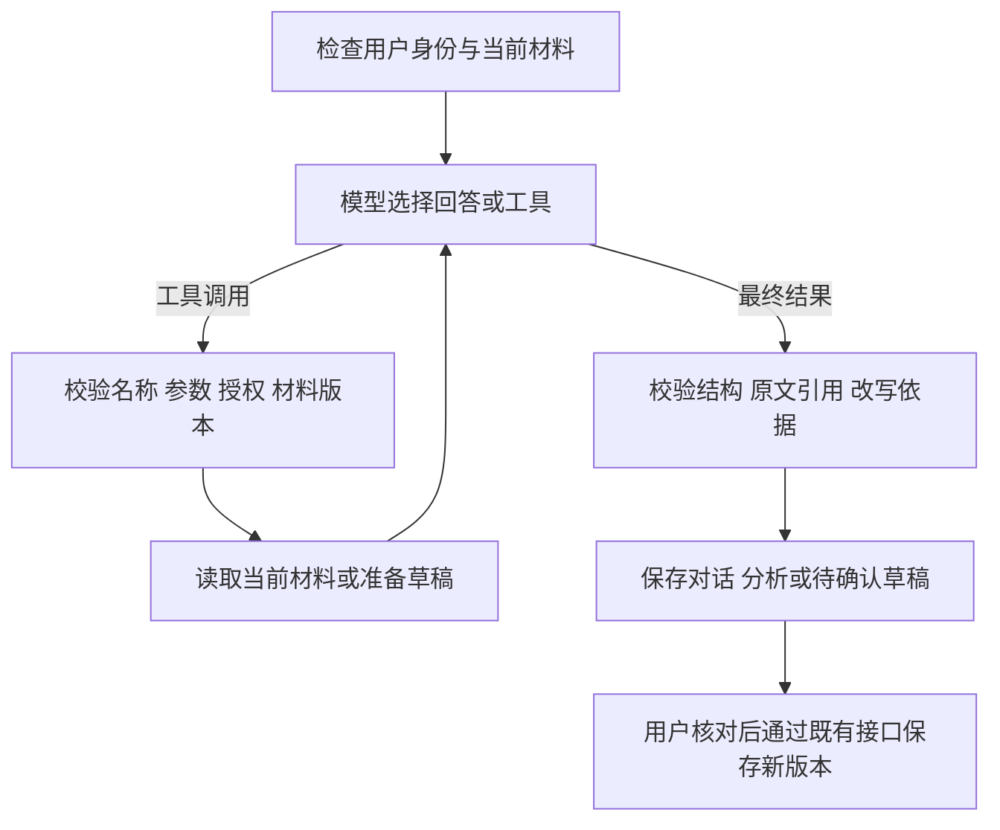

# 求职者材料 Agent：第一阶段

实现日期：2026-10-27。范围：当前求职者任务选中的简历、已确认补充、已选岗位。

## 使用方式

进入求职者 **AI 工作区**，选择材料及 DeepSeek 官方模型。输入区下方默认勾选“材料助手”。

例如输入：“请定位 Python 项目，对照当前岗位，并生成表达优化草稿。”助手按需读取材料、定位段落、准备草稿。结果区保留原文、建议及引用依据，点击“确认并保存为新版本”后才写入新简历。原简历保留。

“分析材料”“生成优化草稿”快捷入口也使用已选协作方式。取消勾选可沿用原来的单次请求流程；其他模型继续使用原流程，不会被静默切换到 DeepSeek。

## 执行结构

`app/material_agent.py` 使用真实 LangGraph `StateGraph`，由模型节点与工具节点交替执行。模型通过 Chat Completions `tool_calls` 自主选择有限工具，后端校验名称、参数和范围后执行。最终 JSON 经过现有 `WorkspaceOutput` 和原文证据校验。

工具清单：

| 工具 | 内容 | 边界 |
|---|---|---|
| `read_resume` | 当前简历和已确认的补充段落 | 不接收简历 ID，不读取其他版本 |
| `read_job` | 当前已选岗位原文 | 不接收岗位 ID，不搜索岗位库 |
| `find_experience` | 当前个人材料内的文字检索，最多返回 12 段 | 无结果仅表示当前文字未命中，不判定能力缺失 |
| `prepare_draft` | 按已读取的个人来源选择最多 4 段待改写原文 | 只准备上下文，不调用保存接口 |

工具只能访问服务器准备的脱敏快照。文件路径、账号归属、凭据及数据库访问能力不进入工具输入。普通聊天也可以提出改写；只有 `prepare_draft` 成功准备的段落才能出现在最终改写中。新草稿复用既有逐段确认保存机制。

## 状态、停止与失败

- `WorkspaceTurn.agent` 是新增的可选字段，默认 false，兼容旧调用。前端在 DeepSeek 官方模型且勾选材料助手时设为 true。
- `agent_run` 保存执行 ID、状态、当前步骤与工具完成记录。GET 原有工作区接口即可读取，前端每 1.2 秒在处理期间轮询，离开页面时清理定时器。
- 刷新页面不会重复 POST；服务还在运行时继续读取其进度。工具步骤记录只展示已发生的操作，不展示模型的内部思考文本。
- POST `/ai/workspaces/{id}/cancel` 携带执行 ID。取消后清除运行令牌并增加版本；旧调用即使晚返回，也不能继续执行工具或提交结果。已发送给模型的 HTTP 请求可能要等当前请求结束，不能保证撤回已发生的推理费用。
- 目前不配置 LangGraph checkpoint；不会在服务重启后从某个工具节点自动续跑。持久化的是业务结果和进度。执行租约到期后显示“执行已中断”，用户可以重新发送问题。工具均只读，重试不会重复保存简历。
- 每次最多 6 次模型调用、8 次工具调用，总执行预算 120 秒；单次 HTTP 上限 40 秒。最终结构或证据不合格最多纠正一次，仍受总调用上限约束。
- 每次调用检查现有费用预算，记录模型、耗时、聚合 token、费用和输入哈希；日志不记录原文或凭据。
- 每个节点及最终提交重新检查会话身份、运行令牌、材料版本和岗位可见性。取消、材料变化、授权变化或服务失败时保留原材料与已有结果。

## 验证

- `tests/test_material_agent.py`：真实 LangGraph + 合成账号 + 脚本模型；覆盖聊天生成草稿、确认保存、只读工具范围、原文引用、数字新增阻断、取消、权限变化、循环上限、过期任务、重试与调用审计。
- 旧工作区、材料编辑、模型切换、网关和 HTTP 截止时间测试继续运行。
- `tests/serve_material_agent_preview.py` + `tests/browser_material_agent.py`：隔离数据库及模型替身，覆盖执行中刷新不重发、确认保存、停止后不提交、失败保留输入、重试及五种屏宽。
- `scripts/verify_material_agent.py`：手动执行的 DeepSeek 官方接口冒烟验证，仅发送合成材料，最多 6 次模型调用，结果写入 `artifacts/material-agent/deepseek-smoke.json`，不修改业务数据库。

以上记录第一阶段范围。2026-10-28 已增加岗位查询、多岗位契合度任务、真实流式回答和逐段改写采纳，见[第二阶段与流式协作](求职者Agent第二阶段与流式协作.md)。招聘端工具与持久化节点恢复仍不属于本阶段。服务器部署需另行同步代码与更新运行锁定依赖。
