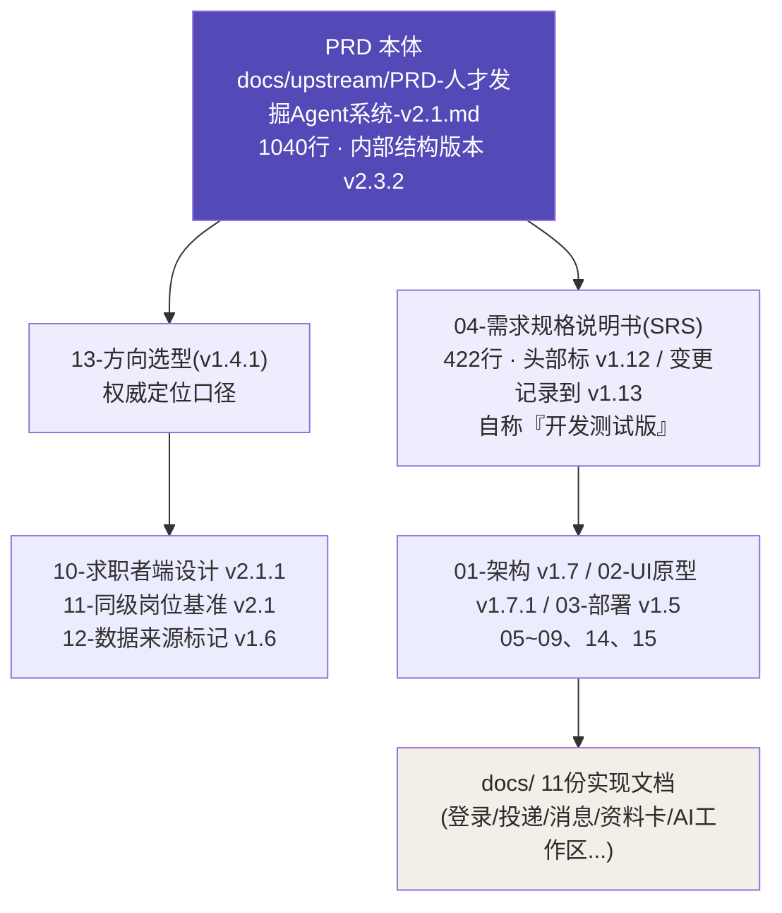
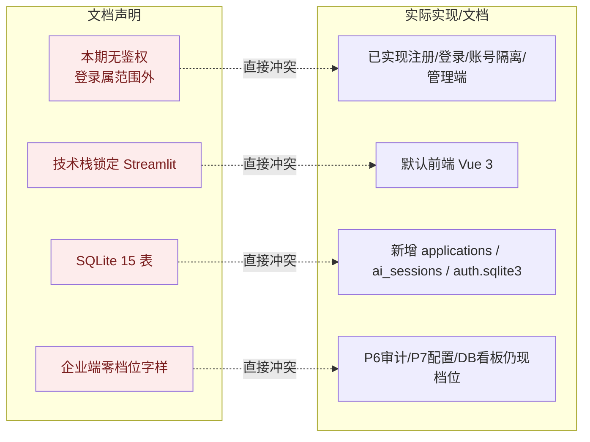

# 项目健康度与逻辑一致性评审报告

| 项 | 内容 |
|----|------|
| 评审对象 | 「同频 · 人才发掘 Agent 系统」全套产品/设计/实现文档（截至 2026-10-14） |
| 评审人 | 维克托（项目管理专家） |
| 评审日期 | 2026-10-14 |
| 评审范围 | 根目录 16 份主文档 + `docs/` 11 份实现文档 + `docs/upstream/` 3 份上游文档，共约 5,900 行；**未评审任何源代码**（按要求仅做文档层评估） |
| 评审方法 | ①基准确立 ②四类一致性核对（需求↔架构↔UI↔实现）③问题登记（按严重度分级）④健康度分维打分 |
| 约束声明 | **本报告为只读评审产物，未修改任何源代码或既有文档**；仅新增本报告文件 |
| 结论摘要 | **设计质量高、文档治理差**——核心风险不是"想错了"，而是"文档说的和实际做的对不上、文档之间互相对不上"。**当前状态下，这 16 份文档不能作为开发/测试的单一依据。** |

---

## 0. 一句话结论

> 这是一套**思考深度远超一般作品项目**的设计文档集（定位清晰、范式自洽、伦理底线明确、红线可执行），
> 但在**完成定位三次翻转（v1.1→v1.4.1）与实现大改（Vue 重构 / 鉴权接入 / 新增四个模块）之后，没有做一次全库回收**，
> 导致出现三类系统性缺陷：**①出口文档（SRS/PRD）落后于实际实现；②文档寻址体系（路径/编号）整体失效；③红线 14 的自查规则与自查对象自相矛盾。**
> 这三类缺陷在评审/答辩场景中是**致命追问点**（"你文档写的 Streamlit，代码是 Vue？""你说本期无鉴权，可你做了管理端？"），必须优先于任何功能开发处理。

---

## 1. 评审依据与文档基准

### 1.1 文档层级（事实核对后）

### 1.2 基准口径（本报告采用）

| 层级 | 文件 | 声明版本 | 本报告定位 |
|------|------|---------|-----------|
| 产品最高权威 | `docs/upstream/PRD-人才发掘Agent系统-v2.1.md` | v2.1（内部结构 v2.3.2），2026-10-10 | **产品意图基准** |
| 定位权威 | `13-方向选型与需求规格化方案.md` | v1.4.1，2026-10-10 | **决策留痕基准** |
| 开发/测试基线 | `04-需求规格说明书-开发测试版.md` | 头部 v1.12 / 记录 v1.13 | **应作为依据，但已失真** |

> ⚠️ **首个重大发现**：SRS（04）头部声明的"依据文档"写的是 `docs/recruit/01~15`、`docs/05~07`，而工作区**根本不存在 `docs/recruit/` 目录**——01~15 号文实际位于根目录，05/06/07 号文另有同名但内容不同的文件在根目录与 `docs/upstream/`。**"依据文档"无法被定位 = 依据链断裂。**

---

## 2. 整体健康度评分

| # | 维度 | 评分 | 判定依据（关键事实） |
|---|------|------|---------------------|
| 1 | **目标与范围清晰度** | 🟡 中 | 定位（双边偏好匹配平台）、范式（区间档位、零总分）、红线（14 条）清晰且自洽；但范围声明与实现严重脱节（见 H-02/H-03） |
| 2 | **文档一致性与版本治理** | 🔴 低 | 文档集对齐全库分裂在 4 个不同上游版本（PRD v1.2 / v2.0 / v2.1 / v2.3.2）；评审报告整份过期（H-06） |
| 3 | **需求可追溯性（RTM）** | 🔴 低 | 已实现的四个模块（投递/消息/资料卡/AI 工作区）在 SRS 范围内**无任何需求编号**（H-04） |
| 4 | **产品伦理红线设计与落地** | 🟢 高（设计）/ 🟡 中（落地） | 红线 14 设计成熟；但自查脚本与自查对象自相矛盾（H-05），企业端看板仍在用档位口径（H-08） |
| 5 | **架构与技术对齐** | 🔴 低 | SRS/PRD/01/02 四方声明 Streamlit，实际默认前端为 Vue 3（H-02） |
| 6 | **可验证性与证据链** | 🟡 中 | 指标体系与评测脚本设计完备；但**标注集未落地、数值指标无实测**，多处文档把"设计完成"呈现为"接近完成"（H-11） |
| 7 | **交付与运维文档** | 🔴 低 | 03 部署文档引用 6 类不存在的文件/模块（H-07） |
| 8 | **排期与范围可控性** | 🟡 中 | M1 6-7 周范围明确、含裁剪顺序；但**未计入已额外实现的鉴权/投递等模块工作量**，实际工作量已超出原 M1 定义（H-13） |

### 综合评级

| 维度 | 权重 | 得分 | 加权 |
|------|------|------|------|
| 设计/思考质量（目标、范式、伦理） | 30% | 88 | 26.4 |
| 文档治理与一致性 | 30% | 38 | 11.4 |
| 实现与需求对齐 | 20% | 35 | 7.0 |
| 可验证性闭环 | 20% | 55 | 11.0 |
| **总分** | | | **≈ 56 / 100 · 中等偏下** |

> **定性判断**：**设计层可以打 85+，治理层不及格。** 若把项目当作"作品/原型"看，"做得比写得好"；若把文档当作"交付依据"看，**当前不可用**。这两者的落差本身就是最大风险——**面试官看不到你的代码质量，只能看到你的文档，而文档现在会撒谎。**

---

## 3. 问题登记表（按严重度）

> 严重度定义：**P0 阻断** = 直接导致评审/交付失败或文档不可作为依据；**P1 高** = 会误导开发/测试或造成口径分裂；**P2 中** = 影响维护性/可读性；**P3 低** = 细节。

### 3.1 P0 阻断级

| 编号 | 问题 | 所在文档及位置 | 影响 | 建议 |
|------|------|---------------|------|------|
| **H-01** | **依据链断裂**：SRS/架构/UI/部署等 9 份文档引用 `docs/recruit/01~15`、`docs/07 定级量规与配置表`，**该路径不存在**；`docs/06`/`docs/07` 与根目录同名编号文档内容完全不同 | `04:9`、`01:3-4`、`02:3`、`03:4`、`10:3`、`11:4`、`15:3`、`14:458` | 任何人（含评审人/新成员）**无法沿依据链找到上游文档**，文档集整体不可审计 | 建立**文档索引表**（编号 → 实际路径 → 版本 → 状态），全库替换失效路径；根目录与 `docs/` 编号去重 |
| **H-02** | **技术栈声明失效**：SRS §3 角色使用端、§5 兼容性、§7"技术栈（锁定）"、PRD §7 兼容性均写 **Streamlit**；实际默认前端已重构为 **Vue 3 + TS + Vite**（README、`docs/前端重构与技术说明.md`、`docs/implementation-decisions.md`） | `04:117-128,284,363`；`01:26`；`02:40,133,150`；`PRD:742` **vs** `README:3,40`；`docs/前端重构与技术说明.md:5` | 基线文档与实况直接冲突；"技术栈锁定"表述失效 | SRS/PRD/01/02 四处统一改为"Vue 3（默认）+ Streamlit（归档参考）"，并说明变更时点 |
| **H-03** | **鉴权范围声明与实现冲突**：SRS §5"安全｜**本期无鉴权（明示）**"、§2.2 把"登录鉴权与权限体系"列为**范围外**；实际已实现验证码注册/密码登录/账号隔离/企业资质审核/平台管理端 | `04:282,96` **vs** `docs/登录与账号隔离.md:5,39,94-106`；`README:108,127-133` | "范围外"的功能已经上线，范围声明失真；也影响 §2.2 的"不做"承诺可信度 | 二选一：①把登录鉴权**正式纳入范围**（新增 AU/SYS 之外的编号，如 ACC-001）；②明确标注为"M1 之外的扩展实现"。**不得再保留"本期无鉴权"字样** |
| **H-04** | **需求追溯断裂**：投递与双向选择、消息中心、招聘个人资料卡、求职者 AI 工作区**四个已实现模块**，在 SRS §2.1 范围表与 PRD §3 中**无任何需求编号**；新增表 `applications`、`ai_sessions` 亦不在"15 表"口径内 | SRS `04:80-92`、`PRD:762`；`docs/投递与双向选择.md:24`、`docs/AI工作区.md:58`；`README:44-47` | RTM 反向断链——**已交付的东西在需求文档里不存在**，无法追溯来源、无法验收、无法评估范围蔓延 | 新增模块编号（建议 AP 投递 / MS 消息 / PRO 资料卡 / AIW 工作区），补入 SRS §2.1 与 §4，并同步 RTM |
| **H-05** | **红线 14 自查规则与自查对象自相矛盾**：02 UI 文档自己定义 `ENT_SIDE_PAGES` 含 **P6 审计中心、P7 配置中心**（企业端），但 P6/P7 正文本身出现"档位/评级/B1~B5"；按文档自设的自动断言执行**必然失败** | `02:377`（P6 断言文字含禁词）、`02:401,406,409`（P7 含"档位锚点/B1~B5"）、`02:681`（ENT_SIDE_PAGES 含 P6/P7）、`02:684-686` | "文档自己定的规则管不住自己"；自动断言上线即红灯，或被迫放宽而形同虚设 | 明确区分**"元规则描述文本"与"企业端 UI 文案"**（断言应只扫 UI 文案节点）；或把 P6/P7 从企业端禁词范围中显式豁免并说明理由 |
| **H-06** | **UI 评审报告整份过期**：`15-UI高保真设计文档评审报告.md` 评审对象为 **v1.6 / 612 行**，现存 02 文档已 **v1.7.1 / 702 行**；其 3 个 P0 + 关键 P1 **均已修复**，全部行号锚点失效 | `15:3,6,11-17,151-258,293` **vs** `02:4,116-150,253-261,519` | 评审结论不可作为当前输入；若被引用会造成"已修复问题被当作未修复"的重复返工 | 在 15 号文头部加**"本报告针对 v1.6，已被 v1.7.1 超越，结论仅作历史留痕"**标注；或按 v1.7.1 重做一轮评审 |
| **H-07** | **部署文档引用 6 类不存在的实体**：`requirements-api.txt`/`requirements-web.txt`、`config/rubric.v0.9.json`、`pipelines/*`（load_config 等 8 个模块）、`eval/*` 均无对应文件；compose 声明 2 服务，而仓库存在 `frontend/`(Vue)+`docker/frontend.conf` | `03:89,100,137,141,276-282,351-372`；仓库实际为 `config/rubric.json`、`scripts/*.py` | 按文档无法复现部署；一键交付能力（核心卖点之一）无法被验证 | 按实际仓库重写 03 的目录/命令/服务清单；`config/rubric.v0.9.json` → `config/rubric.json` |

### 3.2 P1 高级

| 编号 | 问题 | 所在文档及位置 | 影响 | 建议 |
|------|------|---------------|------|------|
| **H-08** | **企业端看板仍用档位口径**：SRS §4.6 DB-001"批次**档位分布**、各维**档位分布**"（企业端可见），与红线 14"企业端不出现档位字样"直接矛盾；EV-005/EV-006 已打补丁，**DB 层漏打** | `04:200`（DB-001）对比 `04:268`（红线14）、`04:315`（企业端断言） | 看板是企业端页面，若不改则红线落地不完整 | DB-001 改为"与岗位要求的**关系分布**"（高于/相符/低于）；与 EV 层措辞统一 |
| **H-09** | **AI 偏差提示落地不全**：SRS/PRD 要求结果页**首屏与页脚**均含"可能存在偏差"+"不设合格线"两要素；02 文档 P5 无页脚提示、P11/P13/P14 页脚**缺"可能存在偏差"** | `02:310,353,437,532,586,616`；断言 `02:688-690`；基准 `04:228,230,315` | 与自查脚本断言冲突；伦理护栏存在缺口 | 补齐 4 个页面的偏差提示两要素；统一 `RESULT_PAGES` 清单 |
| **H-10** | **响应式断点四处口径不一**：PRD §7=1366/1440/1920；SRS §5=≥1200/768–1199/<768；02 §2.2.2=≥1200/768–1199/<768；视觉规范=1440/1024/360 | `PRD:742`；`04:284`；`02:142-150`；`docs/前端视觉与交互规范.md:25` | 测试验收标准不唯一 | 指定 02 §2.2.2 为唯一口径，其余引用它 |
| **H-11** | **可验证性未闭环 + 进展表述落差**：`implementation-decisions.md` 明确"独立人工标注校准结果仍未提供""不伪造 20 对标注"；`verification.md`"未调用真实模型"；但全库多处把"上游已对齐"呈现为接近完成（SRS §1.3 列出 ≥75%/≥90%/+15pp 等硬指标） | `docs/implementation-decisions.md:26-28,30`；`docs/verification.md:32,60,62`；`04:48-59` | 面试第一必问"这些数字实测了吗"，答不上则整套"可验证"卖点反噬 | 在 SRS §1.3 每项指标后加"**实测状态**"列（未实测/部分实测/已达标）；README/文档统一口径，**不把设计完成说成指标达标** |
| **H-12** | **内部档位口径与企业端禁词的系统性张力**：SRS 的 EV-005/EV-006/§4.6 等需求**摘要本身**仍以"档位"为企业侧产物，仅靠验收条款打补丁；§1.2 也用"量规定级（档位 B1~B5）"描述企业侧核心能力 | `04:40,170,171,200` | 读者无法判断"档位到底能不能出现在企业端" | 增设**"内部数据模型 vs 呈现层"边界声明段**（01 号文 v1.7 已有"会渲染给用户看的字才受红线 14 管"的表述，应提升为全库通用约定并被 SRS 引用） |
| **H-13** | **实际工作量超出 M1 定义**：M1=「PM-001~005+RQ-001+JD/MT/EV/TM-001+SYS/AU/DB+部署+评测」6-7 周；但**鉴权体系、投递/消息/资料卡/AI 工作区、模型切换**等已实现内容**不在 M1 清单内**，也无排期归属 | `04:365-366`；`13:570-577`；`README:44-47,108` | 排期与实际交付脱节；范围蔓延风险（13 号文自评"中"实际更高） | 增列"M1 外已实现项"清单与工作量归属，重估剩余工期 |
| **H-14** | **数据源决策未收口**：13 号文 §3.5 允许 24365"仅作素材、不列实时依赖"；14 号文主张升级为"合法 L2 候选源"并**提议改写红线表**（自称"待拍板"） | `13:320-333`；`14:19,215-219,457,460` | 红线 5 的"24365 例外"边界不清，存在合规口径漂移 | 拍板：维持"仅素材"或正式纳入 L2；结果写入 PRD 红线 5 与 13 号文，删除"待拍板"悬空状态 |

### 3.3 P2 中级

| 编号 | 问题 | 所在文档及位置 | 建议 |
|------|------|---------------|------|
| H-15 | **文档集对齐全库分裂**：06/07/08/09 对齐 PRD **v2.0**，03 对齐 13 号文 **v1.2**+PRD **v2.1**，05 对齐 PRD **v1.2**，09/14 无版本号 | `06:3`、`07:1`、`08:4`、`03:3-4`、`05:4`、`09:1-5` | 每份文档头部统一补"版本 + 日期 + 依据文档版本"三件套 |
| H-16 | **SRS 自身文档缺陷**：§4.12"看板（DB）"标题下**无内容**（与 §4.6 重复空节）；§8.2 待确认项**编号重复**（两个 #11、两个 #12）；§3 出现**两条"系统运维者"角色行**；§1.3 指标口径反复（v1.11 称"支撑 10 项"、v1.13 称"11 项"，正文逐项数亦对不上 4+11+3=18） | `04:272`、`04:391-395`、`04:127-128`、`04:70` | 删除 §4.12 空节；重排待确认编号；合并重复角色行；指标数与列表对齐 |
| H-17 | **03 部署文档内部版本自相矛盾**：正文引"PRD v2.2/v2.3"，"依据"行写"PRD **v2.1**" | `03:3` vs `03:4` | 统一为 PRD v2.1（结构版本 v2.3.2） |
| H-18 | **07 号文内部矛盾**：称 A/B/C 三方向"**已全部落地**"，§6"下一步"仍写"选定采纳范围……我按上表改 PRD" | `07:5,69` vs `07:86` | 删除已完成的"下一步"，或标注完成时点 |
| H-19 | **implementation-decisions.md 新旧并存**：同文档一边"默认前端改为 Vue"，一边"保留 FastAPI + Streamlit"；一边"当前演示身份头不是身份认证、生产写入禁用"，一边新增"账号隔离已接入" | `docs/implementation-decisions.md:5` vs `:12`；`:30` vs `:56-58` | 以时间线方式重排，旧口径加"历史说明" |
| H-20 | **06 号文结论与后续设计冲突未标注**：06 判"候选人侧自助（查看自己的评估）→ ❌ 不做"，与后续 TM 层/求职者端设计直接冲突 | `06:43` | 加"该结论已被 13 号文 v1.2 推翻"标注 |
| H-21 | **跨文档口径不一（标注集/模型/测试计数）**：标注集 20 对（07/08）vs 50 对（03）；`LLM_MODE=deepseek`（AI工作区）vs `live`（模型选择）；后端测试计数 107/129/143/170/181/250 各文档不同 | `03:93,281` vs `07:87`、`08:138`；`docs/AI工作区.md:21` vs `docs/模型选择与切换.md:18`；各 docs | 建立"指标/常量集中登记表"，各文档统一引用，标注"截至版本" |
| H-22 | **两套前端视觉规范并存**：02 §2.1 色表（主色 #534AB7 等）与 `docs/前端视觉与交互规范.md`（#292344 等）**无一处色值重合** | `02:91-98` vs `docs/前端视觉与交互规范.md:7-8` | 指定唯一设计系统来源；另一份作废或标注适用端 |
| H-23 | **已定义功能在 UI 文档无落地**：DB-001/002 看板、SYS-005 环境隔离清理、TM-002 结构视图三区块，在 02 页面清单（P1~P14）中**均无对应页面** | `04:91,186,244`；`02:416-446,627-651` | 补页面或标注"由配置页/后台承载" |

### 3.4 P3 低级

| 编号 | 问题 | 位置 |
|------|------|------|
| H-24 | 评审报告"共 15 组配色对"实列 13 行 | `15:27-43` |
| H-25 | 待确认 #13 仍按"存疑"统计卡描述，与现行"规则未通过"命名不符 | `02:669`；`04:392` |
| H-26 | 规则编号"规则 R-03"在 SRS 中未定义编号集 | `02:261` vs `04:156` |
| H-27 | SRS 头部版本（v1.12）滞后于自身变更记录（v1.13） | `04:5` vs `04:420` |
| H-28 | `in-sync/README.md` 为空文件（0 字节），目录意图不明 | `in-sync/README.md` |

### 问题分布热力

| 层 \ 严重度 | P0 | P1 | P2 | P3 |
|---|---|---|---|---|
| 出口文档（SRS 04 / PRD） | H-03, H-04 | H-08, H-11, H-12 | H-16, H-27 | — |
| 架构·UI（01/02/15） | H-05, H-06 | H-09, H-10 | H-22, H-23 | H-24, H-25, H-26 |
| 定位·设计（13/10/11/12） | H-01 | H-14 | — | — |
| 部署·支撑（03/05/06/07/08/09/14） | H-07 | — | H-15, H-17, H-18, H-20, H-21 | H-28 |
| 实现文档（docs/*） | H-02 | — | H-19 | — |

---

## 4. 逻辑一致性专项（按你要求的三类）

### 4.1 流程矛盾（Process Contradiction）

| 编号 | 矛盾 | 定位 |
|------|------|------|
| C-1 | "本期无鉴权 / 登录属范围外" **vs** 已实现完整鉴权+管理端 | H-03 |
| C-2 | "技术栈锁定 Streamlit" **vs** 默认前端 Vue 3 | H-02 |
| C-3 | "SQLite 15 表" **vs** 实际新增 3 类表/库 | H-04 |
| C-4 | "企业端不出现档位字样" **vs** P6/P7 正文、DB 看板仍现档位 | H-05, H-08 |
| C-5 | 部署文档"2 服务" **vs** 仓库存在第 3 个前端服务 | H-07 |
| C-6 | 06 号文"候选人侧自助不做" **vs** 后续 TM/求职者端设计 | H-20 |

### 4.2 功能缺失（Missing Capability）

| 编号 | 缺失 | 定位 |
|------|------|------|
| M-1 | 四个已实现模块**无需求编号**（投递/消息/资料卡/AI 工作区） | H-04 |
| M-2 | DB-001/002 看板无 UI 页面 | H-23 |
| M-3 | SYS-005 环境隔离/清理无 UI 入口 | H-23 |
| M-4 | TM-002 结构视图三区块在 P8 无落地 | H-23 |
| M-5 | 标注集未落地 → 全部数值指标无实测支撑 | H-11 |
| M-6 | 大部分文档无版本号/日期（05 之外，06/07/09/14/README/视觉规范/技术说明 均缺） | H-15 |

### 4.3 前后不一致（Inconsistency）

| 编号 | 不一致 | 定位 |
|------|--------|------|
| I-1 | 响应式断点：1366/1440/1920 **vs** ≥1200/768 **vs** 1440/1024/360 | H-10 |
| I-2 | 标注集 20 对 **vs** 50 对 | H-21 |
| I-3 | `LLM_MODE` = deepseek **vs** live | H-21 |
| I-4 | 测试计数 107/129/143/170/181/250 各说各话 | H-21 |
| I-5 | 两套互不重合的配色系统 | H-22 |
| I-6 | 03 号文内部 PRD 版本 v2.1 **vs** v2.2/v2.3 | H-17 |
| I-7 | 07 号文"已全部落地" **vs** "下一步：选定采纳范围" | H-18 |
| I-8 | implementation-decisions 内部 Vue **vs** Streamlit / 无鉴权 **vs** 已鉴权 | H-19 |
| I-9 | SRS 头部 v1.12 **vs** 变更记录 v1.13 | H-27 |
| I-10 | 评审报告（针对 v1.6）**vs** 现存 UI 文档 v1.7.1 | H-06 |

---

## 5. 改进建议（按优先级与动作类型）

### 5.1 立即执行（本周内，0 成本·高收益）

| # | 动作 | 责任 | 截止 |
|---|------|------|------|
| 1 | **建立文档索引表（SSOT）**：编号 → 实际路径 → 版本 → 日期 → 状态；全库替换失效路径（H-01） | 作者 | 2026-10-16 |
| 2 | **SRS/PRD 回写已实现事实**：技术栈改 Vue、删"本期无鉴权"、数据表清单更新、四个模块补编号（H-02/03/04） | 作者 | 2026-10-17 |
| 3 | **在 15 号评审报告头部加"已过期"标注**（H-06） | 作者 | 2026-10-15 |
| 4 | **修红线 14 落地三处**：P6/P7 断言范围、4 个页面页脚偏差提示、DB 看板改关系语义（H-05/08/09） | 作者 | 2026-10-18 |
| 5 | **统一响应式断点为 02 §2.2.2**（H-10） | 作者 | 2026-10-16 |

### 5.2 短期（两周内）

| # | 动作 | 建议 |
|---|------|------|
| 6 | 建立**版本治理三件套**（版本+日期+依据文档版本），逐份补齐 | H-15, H-16~H-28 |
| 7 | 修复 03 部署文档的失效引用与命令（按实际仓库重写 §7/§11） | H-07 |
| 8 | 修复 SRS 自身缺陷（空节/编号重复/角色重复/指标口径） | H-16 |
| 9 | 修复 07/implementation-decisions/06 的内部矛盾与陈旧结论 | H-18/19/20 |
| 10 | 建立"指标与常量集中登记表"，消除 20/50 对、LLM_MODE、测试计数分歧 | H-21 |

### 5.3 中期（一个月内）

| # | 动作 | 建议 |
|---|------|------|
| 11 | **闭环可验证性**：落地 20 对最小标注集，实测核心/支撑指标，SRS §1.3 增"实测状态"列 | H-11 |
| 12 | **决策收口**：24365 数据源定位、看板是否保留、C 档基准是否保留——三项写入 PRD 并删除"待拍板" | H-14 |
| 13 | 重估 M1/M2 排期：把已实现的鉴权/投递/消息/资料卡/AI 工作区纳入工作量与排期 | H-13 |

---

## 6. 下一步（建议立即做的 3 件事）

| 顺序 | 事项 | 为什么是它 | 验收标准 |
|------|------|-----------|---------|
| **1** | **建立文档索引表 + 修路径**（H-01） | 依据链断裂是**所有其他问题无法被系统排查**的根因；不先做这个，改一处漏一处 | 全库任意"依据文档 X"引用都能一键定位到真实文件与版本 |
| **2** | **SRS 回写实现事实**（H-02/03/04/08） | 出口文档是评审/测试的唯一入口；它撒谎则整个交付不可信 | SRS 的技术栈、鉴权范围、数据表、模块编号与仓库实况一致 |
| **3** | **红线 14 自查闭环**（H-05/09） | 伦理护栏是本项目最大差异化卖点，而当前**自查规则本身失效** | 自动断言跑通且绿灯，或断言范围被正式收窄并说明理由 |

---

## 7. 结语

这套文档的**思想性相当出色**——"审查不对称"的洞察、区间档位取代综合分、企业端说差距/求职者端说距离的伦理设计，都是能拿分的东西。但它现在的问题不在想，而在**收尾**：

> 三次定位翻转、一次前端重构、四个模块新增之后，**没有一次全库回收**。
> 结果就是：**最值钱的部分（设计）藏在最不值钱的包装（失同步的文档）里。**

好消息是——**上述 P0 问题全部是"文档工作"，不需要改一行代码**，两周内可以清零；而且清零之后，这套文档的完成度会立刻配得上它自己的设计水准。

---

> 合规输出声明：本报告为产品设计参考与项目管理建议，不构成法律或合规意见；涉及个保法/平台条款的边界判断请结合法务确认。
